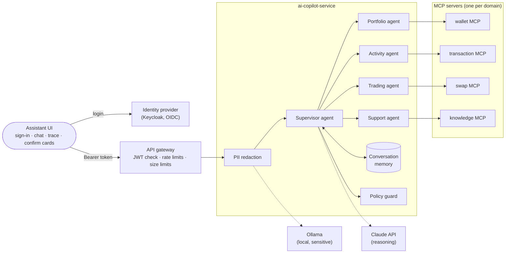

# From demo to production: an agentic support system

This is the roadmap for turning the copilot into a production-style **agentic AI system**, following
the steps of "Demo to Production: Architect a Real Agentic AI System". The video builds a banking
support agent; here the same architecture runs on OpenCrypto's real services.

| Banking example in the video | OpenCrypto version |
|---|---|
| "What is my account balance?" | "What's my portfolio worth?" (`get_portfolio`) |
| Last transactions, statements | Activity and swap history (`get_transactions`, `get_swaps`) |
| Accounts / transactions / service agents | Portfolio / Activity / Trading / Support agents |
| "Increase my credit limit to 5 lakh" (only some tiers may) | "Raise my deposit limit" (only PREMIUM/PRIVILEGED tiers) |
| "The one I flagged as suspicious last week" | Flag an activity item; the copilot remembers it next session |
| Credit card number typed into chat | Card numbers, emails, phones, wallet addresses in chat |
| "Confirm the delivery address before ordering a checkbook" | Confirm the withdrawal address before saving it |
| Agent says 18,200 when the balance is 52,340 | Number-grounding check in the eval: every number must come from a tool output |

## Who builds what

The goal is to learn agent engineering, so the split is deliberate:

- **Platform (infra + UI, built for you):** model clients, tool adapters, MCP servers, identity provider
  and token checks, tiers and permissions, conversation store, PII redaction, policy and confirmation
  plumbing, agent tracing and dashboards, eval tooling, and every screen.
- **You (the agent):** the tool-use loop, the supervisor and sub-agents, prompts, memory usage, model
  routing decisions, and the eval rubric. Each step below says what "done" means, usually as a test or an
  eval case that has to pass.

Stack: Java 21, Spring Boot 3.5, **Spring AI 1.1** (`ChatClient`, tool calling, MCP client/server),
**Claude** for reasoning and a **local Ollama model** for steps that see personal data.

## Target architecture

## The steps

Each step starts with the problem the video shows, so you can reproduce it before fixing it.

### Step 0. Platform ready for Spring AI (platform)

- **Problem:** Spring AI 1.0.x and 1.1.x are built on Spring Boot 3.5; the repo was on 3.4.
- **Done:** whole repo on Spring Boot 3.5.15 / Spring Cloud 2025.0.3, gateway on the new
  `server.webflux` property prefix, `mvn verify` green. Notes: [13-agentic-foundation.md](../engineering/13-agentic-foundation.md).

### Step 1. A plain LLM can't answer "what's my balance?" (you)

- **Problem:** a model with no tools either says "I don't have access" or makes a number up.
- **Platform gives you:** a configured Claude `ChatClient` and the Assistant page.
- **You build:** an `LlmCopilotEngine` that sends the question with no tools. Ask "what's my portfolio
  worth?" and save the answer. That is your "demo" baseline.
- **UI:** the Assistant page shows engine, model, latency and tokens for every answer.
- **Done:** `LocalCopilotEngine` (engine `local`, Ollama `qwen2.5:3b`, no tools). It refuses with the
  "never invent a number" prompt; without one it invented a $30,000 portfolio worth $48,455. The AI route
  in the gateway got its own 130 s timeout. Eval baseline (seed 42): 0/50 answered from a tool vs 35/50 for
  `deterministic`, 0 invented dollar amounts, p50 9.7 s on a CPU. Notes: [14-plain-llm-baseline.md](../engineering/14-plain-llm-baseline.md).

### Step 2. Tool-calling agent (you)

- **Problem:** the model needs real data, but too many tools in one prompt makes it pick the wrong one
  (the video's "tool overload").
- **Platform gives you:** the 11 typed tools as Spring AI tool callbacks, with the caller bound from the
  request, never from the model.
- **You build:** the tool loop. Write it by hand first (turn off Spring AI's internal tool execution) so
  you see every round trip, then compare with the built-in loop.
- **Done when:** beats the `deterministic` engine on `run_eval.py --seed 42`, with no regressions on
  OC-009 to OC-013 and OC-048 to OC-050.
- **UI:** the trace panel shows each tool call with its input, output, error and duration.

### Step 3. Domain sub-agents with a supervisor (you)

- **Problem:** one agent with every tool and one long prompt gets slower, costlier and less accurate.
- **You build:** Portfolio, Activity, Trading and Support agents, each with only its own tools and
  prompt, and a supervisor that splits "my balance **and** my last five transactions" into two sub-tasks
  and merges the answers.
- **Done when:** routing accuracy measured on the eval set (which agent handled each case), and
  multi-part questions answered completely.
- **UI:** every answer shows which agents ran, in what order, with their own tool calls nested under them.

### Step 4. One MCP server per domain (platform, then you)

- **Problem:** tools compiled into the AI service couple it to every other service; the wallet team can't
  change a tool without redeploying the copilot.
- **Platform builds:** MCP servers (Spring AI MCP server, streamable HTTP) in wallet-, transaction-,
  swap- and the knowledge part of ai-copilot-service, each owning its tools. They are internal only: the
  gateway never routes `/mcp`.
- **You do:** switch your sub-agents from in-process tools to MCP clients, one per domain.
- **Done when:** the same eval results as step 3, and a tool changed in wallet-service shows up without
  rebuilding the AI service.
- **UI:** the trace shows which MCP server answered each call; the Status page lists the MCP servers.

### Step 5. Authentication with an identity provider (platform)

- **Problem:** anyone can send `X-Demo-User: alice` and read Alice's portfolio. Phase 1 kept this header
  on purpose; this step replaces it, with a one-click demo login so the demo stays easy.
- **Platform builds:** Keycloak in Compose with demo users, OIDC login with PKCE in the UI, JWT
  validation at the gateway, identity forwarded to services from the token only (incoming identity headers
  are stripped), and the user's token passed on to the MCP servers.
- **UI:** sign-in page, user menu, session expiry handling.

### Step 6. Tier-based authorization (platform, then you)

- **Problem:** "raise my limit" must work for a PRIVILEGED customer and be refused for a STANDARD one,
  and the refusal must not depend on the prompt.
- **Platform builds:** a `tier` claim (STANDARD / PREMIUM / PRIVILEGED), per-tier deposit limits in
  wallet-service, a limit-increase request that the service authorizes, and a proposed-action type for it.
- **You build:** the agent behaviour: propose when allowed, explain politely when not, never claim it
  changed something.
- **Done when:** the same question from two tiers gives two different, correct outcomes, enforced by the
  service even if the model is tricked.
- **UI:** tier badge, limit shown in Wallet, a clear "not available on your tier" card.

### Step 7. Memory: conversations and shared state (platform, then you)

- **Problem:** "was that the one I flagged last week?" fails because every request is stateless.
- **Platform builds:** a conversation store (Postgres, `ai` schema): conversations, messages, and a
  per-user state the agents share; a "flag as suspicious" action on activity items.
- **You build:** what to remember and how: full history vs summary, what the supervisor passes to
  sub-agents, when old context is dropped.
- **Done when:** the flagged-transaction scenario works across sessions, and memory never leaks between users.
- **UI:** conversation list, rename/delete, "what the assistant remembers" view.

### Step 8. PII redaction and model routing (platform, then you)

- **Problem:** a user pastes a card number; it must never reach a third-party model or the logs.
- **Platform builds:** a redaction service: deterministic detectors (Luhn-checked card numbers, email,
  phone, IBAN, wallet addresses) that replace values with placeholders (`<CARD_1>`), a short-lived
  vault to restore them only inside the tool layer, log masking, and an Ollama `ChatClient`.
- **You build:** routing: which steps may go to Claude (redacted text only) and which run on the local
  model, plus an optional local-model detector for names and addresses the patterns miss.
- **Done when:** a PII eval set shows zero raw values in model requests, traces and logs.
- **UI:** masked values shown as chips ("card ending 4242 hidden from the AI").

### Step 9. Policies and human confirmation (platform, then you)

- **Problem:** "always confirm the address before ordering" must be guaranteed, not hoped for.
- **Platform builds:** a policy guard that checks every proposed action against rules kept as data, and
  confirm/reject cards whose confirmation goes straight to the owning service, which validates again.
- **You build:** agents that produce well-formed proposals and ask the confirming question first.
- **Done when:** no state change can happen without a user confirmation, shown by tests that try.
- **UI:** confirmation cards with exactly what will change, plus an audit entry afterwards.

### Step 10. Evaluation (shared)

- **Problem:** answers aren't deterministic; the video's agent confidently reported the wrong balance.
- **Platform builds:** automated checks in `evaluation/`: number grounding (every number in an answer
  must appear in a tool output), routing accuracy, refusal checks, PII leak checks, cost and latency
  per run, saved to the existing `ai_evaluation_*` tables.
- **You build:** the rubric, an LLM-as-judge, and its agreement with your manual labels.
- **UI:** an Evals page: runs over time, side-by-side answers, failing cases.

### Step 11. Agent observability (platform)

- **Problem:** CPU and memory look healthy while the agent gives wrong answers or loops on tools.
- **Platform builds:** spans for every model call, tool call, MCP call and agent handoff in Tempo (with
  model, token counts and cost), metrics for tokens, cost, tool errors and refusals, and a Grafana "Agents"
  dashboard. Prompt text stays out of traces unless redacted.
- **UI:** "View trace" on every answer, opening the request in Grafana.

### Step 12. Edge security (platform)

- **Problem:** an AI endpoint is expensive to call, so it is a cost and denial-of-service target.
- **Already here:** gateway token buckets per user, including a stricter `ai` policy.
- **Platform builds:** request size and prompt length limits, a per-user daily token budget enforced
  before calling the model, and a written design for the layer in front (WAF, DDoS protection,
  TLS) in production.

## Rules for every step

- The AI never changes state itself. It proposes; the user confirms; the owning service validates.
- Identity, tier and permissions come from the validated token, never from model output.
- Tool outputs, retrieved text and memory are data, not instructions.
- Only claim what the eval measured, with the seed and dataset that produced it.
- Every step gets a learning note in `docs/engineering/`.
