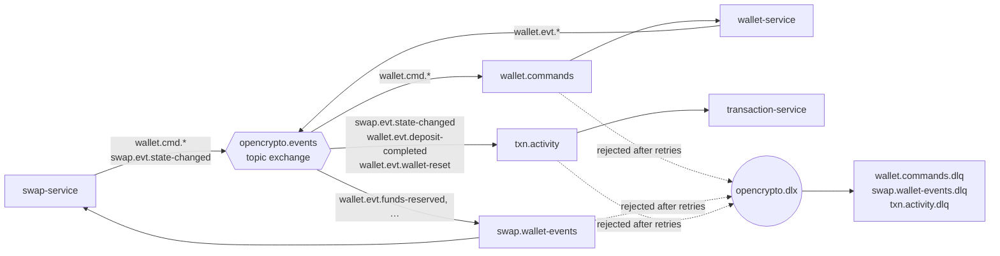

# Messaging contracts

All asynchronous communication goes through one durable **topic exchange** `opencrypto.events`.
Every queue has a dead-letter queue `<queue>.dlq` (via the direct exchange `opencrypto.dlx`).

## Envelope

```json
{
  "messageId": "2f6c…",            // outbox row id: stable across re-publishes, used for dedupe
  "type": "ReserveFunds",
  "occurredAt": "2026-10-25T09:40:01Z",
  "correlationId": "e4c1f288-…",   // also in the x-correlation-id header
  "payload": { … }
}
```

Publishers write to their `outbox_event` table in the business transaction; consumers record
`(messageId, consumer)` in `processed_message` (inbox) in theirs. Delivery is at-least-once;
effects are exactly-once.

## Queues and routing keys

| Queue (consumer) | Binds | Purpose |
|---|---|---|
| `wallet.commands` (wallet-service) | `wallet.cmd.*` | Commands from the swap saga |
| `swap.wallet-events` (swap-service) | `wallet.evt.funds-reserved`, `…reservation-rejected`, `…swap-settled`, `…settlement-rejected`, `…funds-released` | Saga replies |
| `txn.activity` (transaction-service) | `swap.evt.state-changed`, `wallet.evt.deposit-completed`, `wallet.evt.wallet-reset` | Activity read model |

## Topology




## Messages

| Routing key | Type | Payload |
|---|---|---|
| `wallet.cmd.reserve` | ReserveFunds | swapId, userId, asset, amount |
| `wallet.cmd.settle` | SettleSwap | swapId, userId, fromAsset, inputAmount, fee, toAsset, outputAmount, fromPriceUsd, toPriceUsd |
| `wallet.cmd.release` | ReleaseFunds | swapId, userId, reason |
| `wallet.evt.funds-reserved` | FundsReserved | swapId, userId, asset, amount |
| `wallet.evt.reservation-rejected` | ReservationRejected | swapId, userId, reason, detail |
| `wallet.evt.swap-settled` | SwapSettled | swapId, userId, ledgerEntryId, toAsset, outputAmount |
| `wallet.evt.settlement-rejected` | SettlementRejected | swapId, userId, reason |
| `wallet.evt.funds-released` | FundsReleased | swapId, userId, reason |
| `wallet.evt.deposit-completed` | DepositCompleted | userId, entryId, asset, amount, valueUsd |
| `wallet.evt.wallet-reset` | WalletReset | userId, entryId |
| `swap.evt.state-changed` | SwapStateChanged | swapId, userId, state, previousState, failureReason, symbols, amounts, timestamps, path |

## Evolution rules

- Each service keeps its own copy of the shapes it uses (`WalletMessages`, `SwapMessages`); there is
  no shared domain jar.
- Changes are **additive**: new optional fields only; consumers ignore unknown fields.
- A breaking change gets a new `type` (e.g. `SettleSwapV2`) consumed in parallel until producers move.

## Operating it

- Inspect queues and DLQs: http://localhost:15673/#/queues (`MessagesDeadLettered` alerts on DLQ depth).
- A message in a DLQ failed 4 delivery attempts. Fix the cause, then move it back with the
  RabbitMQ shovel or "Move messages" in the management UI.
