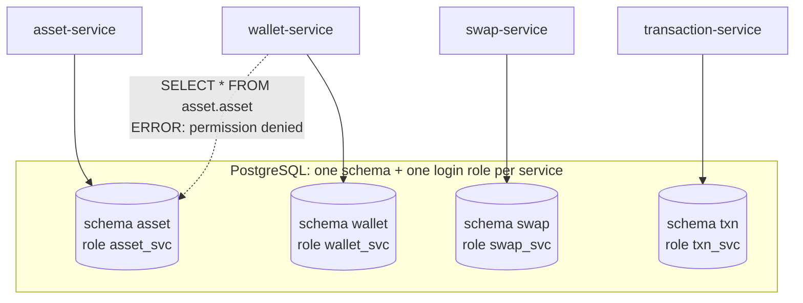
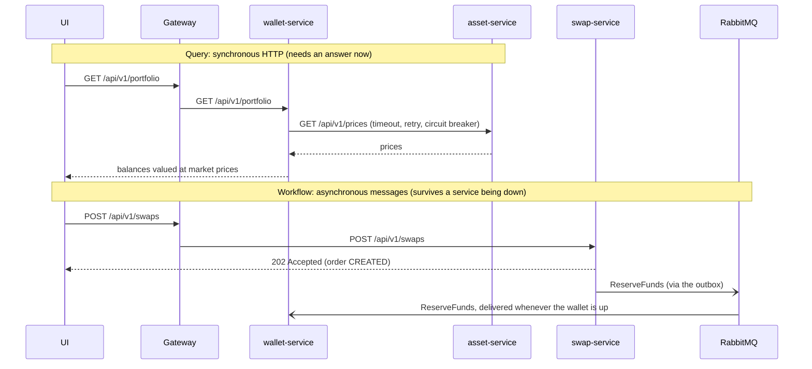

# 1. Architecture & data ownership

## The problem

Microservices fail in two classic ways:

- **The distributed monolith.** Services share one database and read each other's tables. You
  can't change a table without coordinating every team, and a bug in one service corrupts
  another's data. You pay for the network hops without getting independence.
- **Chatty, fragile call chains.** Service A calls B which calls C synchronously for everything.
  One slow service makes everything slow; one dead service takes the whole flow down.

## Options

| Choice | Options | Trade-off |
|---|---|---|
| Data | shared DB · schema per service · DB per service | isolation vs operational cost |
| Communication | sync HTTP · async messaging · both | simplicity vs decoupling/resilience |
| Shared code | copy-paste · shared domain jar · shared *platform* library | duplication vs coupling |

## What we did

**One Postgres, one schema and one login per service.** `infra/postgres/init/001-service-schemas.sh`
creates `asset`, `wallet`, `swap`, `txn` schemas, each owned by its own role (`wallet_svc`, ...).
A service *cannot* read another's tables; it's a permission error, not a convention:

```text
wallet_svc=> SELECT count(*) FROM asset.asset;
ERROR:  permission denied for schema asset
```

Each service owns its tables through **Flyway migrations** in `src/main/resources/db/migration`.
This gives database-per-service isolation without running five Postgres servers locally, and you
can split them onto separate servers later without code changes.

**Sync for queries, async for workflows.**

- Reads that need an answer *now* use HTTP: wallet asks asset-service for prices to value a
  portfolio. These calls have timeouts, retries and circuit breakers ([chapter 6](06-resilience.md)).
- Multi-step business processes that move money use **RabbitMQ**: the swap saga
  ([chapter 4](04-swap-saga.md)). If the wallet is down, commands wait in a durable queue instead
  of failing the user's request.
- Read models are built from **events**: transaction-service never receives HTTP writes; it
  projects `swap.evt.*` and `wallet.evt.*` events into an activity table (CQRS-style).

**A shared *platform* library, not a shared domain model.** `libs/platform-common` holds
cross-cutting technical code every service needs identically: correlation IDs, RFC 7807 errors,
the transactional outbox and inbox. Business message contracts (`WalletMessages`, `SwapMessages`)
are deliberately *copied* into each service, so the swap team can't break the wallet by editing a
shared class. Contracts evolve additively (new optional fields only).

**The gateway is the only public door.** It routes `/api/v1/**`, applies rate limits and
correlation IDs, and never exposes `/internal/**` or `/actuator/**` (except a read-only health
route per service for the status page).

## Diagrams

**Data ownership.** One Postgres server, but each service can only reach its own schema. The
database enforces the boundary, not a code review.



**Sync for queries, async for workflows.** A query needs an answer now, so it's HTTP with timeouts. A
workflow that moves money is a message, so it waits in a queue if the wallet is down.



## Service map

| Service | Owns | Talks to |
|---|---|---|
| api-gateway | routing, rate limits | Redis (limiter), all services (HTTP) |
| asset-service | catalogue, prices, history, events | CoinGecko (HTTP), Postgres `asset`, Redis |
| wallet-service | ledger, holds, positions, audit | asset-service (HTTP), Postgres `wallet`, RabbitMQ |
| swap-service | quotes, swap orders, state history | asset-service (HTTP), Postgres `swap`, RabbitMQ |
| transaction-service | activity read model | Postgres `txn`, RabbitMQ (consumer) |
| ai-copilot-service | tools, engines, knowledge | all services (HTTP, read-only) |

## See it yourself

```bash
docker compose exec postgres psql -U opencrypto -d opencrypto -c '\dn+'       # schemas and owners
curl -s localhost:8080/internal/v1/anything -o /dev/null -w '%{http_code}\n'   # 404: not routed
```

## Pitfalls

- **Default port clashes.** This machine had native Postgres (5432) and Redis (6379); services
  silently connected to the wrong ones. Docker infra now uses 5433/6380/5673 (see [chapter 10](10-bugs-and-lessons.md)).
- **Shared domain jars** feel DRY but recreate the distributed monolith at compile time.

## Interview questions

- Why not let wallet-service read the `asset` table directly for prices?
- When would you choose messaging over HTTP between two services?
- What belongs in a shared library in a microservice system, and what doesn't?
- How would you move from schema-per-service to database-per-service later?
