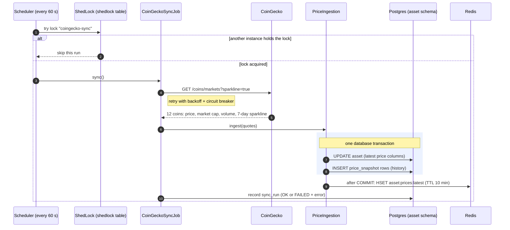
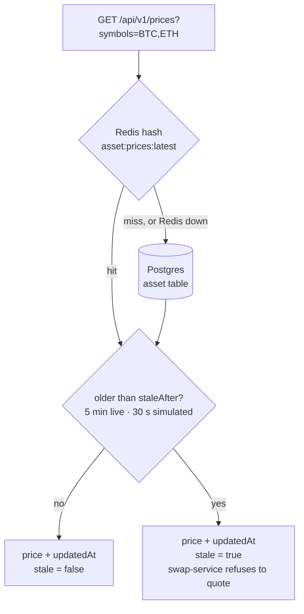
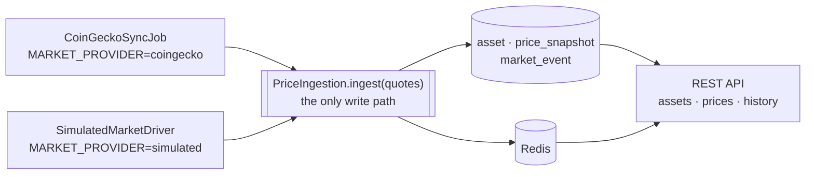

# 2. Market data integration (CoinGecko + Redis + scheduled sync)

## The problem

You need live prices for 13 assets, shown to every user, every few seconds. Calling CoinGecko
per user request would:

- blow through CoinGecko's free rate limit (tens of calls per minute) almost immediately,
- make every page as slow as a third-party API,
- take your app down whenever CoinGecko is slow or down.

You also need **history** (charts, portfolio value over time) that CoinGecko's free tier doesn't
give you per minute, and list pages users can **search, filter, sort and paginate**.

## Options

| Approach | Pros | Cons |
|---|---|---|
| Call CoinGecko on each request | always fresh | rate limits, latency, outages hit users |
| Cache with TTL on read (cache-aside) | simple | first user after expiry pays the latency; thundering herd |
| **Background sync + store + cache** | API calls independent of traffic, history for free | data is up to one interval old |

## What we did

**A background job owns the third-party call.**
[`CoinGeckoSyncJob`](../../services/asset-service/src/main/java/dev/opencrypto/assetservice/market/coingecko/CoinGeckoSyncJob.java)
calls `/coins/markets` **once a minute for all assets**, no matter how many users there are.
User requests never call CoinGecko.

**ShedLock makes the job run on one instance.** With 3 instances of asset-service, a plain
`@Scheduled` job runs 3 times per minute (3× the quota). `@SchedulerLock` takes a row lock in the
`shedlock` table so only one instance syncs per interval.

**One write path for two providers (ports & adapters).** The CoinGecko job and the simulated
market ([`SimulatedMarketDriver`](../../services/asset-service/src/main/java/dev/opencrypto/assetservice/market/sim/SimulatedMarketDriver.java))
both hand a batch of `MarketQuote`s to
[`PriceIngestion.ingest()`](../../services/asset-service/src/main/java/dev/opencrypto/assetservice/market/PriceIngestion.java).
One transaction updates the latest price columns, appends history rows, and records events. The
rest of the system doesn't know or care which provider is active (`MARKET_PROVIDER`).

**Redis is a cache, Postgres is the truth.** After the ingestion transaction *commits*
(`TransactionSynchronization.afterCommit`), latest prices are written to a Redis hash with a TTL.
[`PriceService`](../../services/asset-service/src/main/java/dev/opencrypto/assetservice/market/PriceService.java)
reads Redis first and falls back to Postgres on a miss **or if Redis is down**. Writing the cache
only after commit means a rolled-back transaction can never leave phantom prices in Redis.

**Freshness is explicit.** Every price carries `updatedAt`, `ageSeconds` and `stale` (older than
5 minutes for live data). Downstream rules use it: swap-service refuses to quote on stale prices.
A failed sync doesn't delete anything; users see the last good prices, flagged stale.

**History without extra API calls.** `/coins/markets?sparkline=true` returns a 7-day hourly series
in the same response. The first sync backfills it into `price_snapshot`; every later sync appends a
point. Charts then query Postgres with `date_bin` down-sampling so a 30-day chart returns at most
~240 points ([`HistoryRepository`](../../services/asset-service/src/main/java/dev/opencrypto/assetservice/market/HistoryRepository.java)).
A retention job keeps the table bounded.

**Pagination, filtering, sorting, safely.**
`GET /api/v1/assets?page=0&size=20&sort=marketCap,desc&q=bit&kind=CRYPTO`. The `sort` parameter is
mapped through a **whitelist** (`AssetRepository.SORTS`) to a SQL column; user text is never
concatenated into SQL. `size` is capped at 100 (`@Max`), and responses use a standard envelope
`{items, page, size, totalItems, totalPages, sort}`.

## Diagrams

**Write path.** One instance, once a minute, no matter how many users. The cache is written only
after the transaction commits.



**Read path.** Redis first, Postgres as the fallback, and every answer says how fresh it is.



**One write path, two providers (ports & adapters).**



## See it yourself

```bash
curl 'localhost:8080/api/v1/assets?size=3&sort=change24h,desc'
curl 'localhost:8080/api/v1/assets?sort=price;DROP%20TABLE%20asset'    # 400 INVALID_SORT
curl 'localhost:8080/api/v1/assets/ETH/history?range=7d&points=50'
curl localhost:8080/api/v1/market/status                                # last sync, circuit breaker
docker compose exec redis redis-cli HGETALL asset:prices:latest | head
```

Kill Redis (`docker compose stop redis`) and prices still load: they come from Postgres.

## Pitfalls

- **ShedLock in tests.** `lockAtLeastFor=15s` means a second call within 15 s is *silently
  skipped*. Tests call the unlocked `syncOnce()` instead (see [chapter 10](10-bugs-and-lessons.md)).
- **Don't leak internal headers to third parties.** The CoinGecko client is built without the
  correlation-id interceptor on purpose.
- **Rounding.** Prices are `NUMERIC(38,18)` and `BigDecimal` end to end. Never `double` for money.

## Interview questions

- Why is a background sync better than cache-aside here? When would cache-aside be better?
- What happens when two instances run the same `@Scheduled` job? How does ShedLock prevent it?
- Why update Redis *after* commit and not inside the transaction?
- How do you stop a `sort` query parameter from becoming SQL injection?
- How do you serve a 30-day chart without sending 43,000 points?
