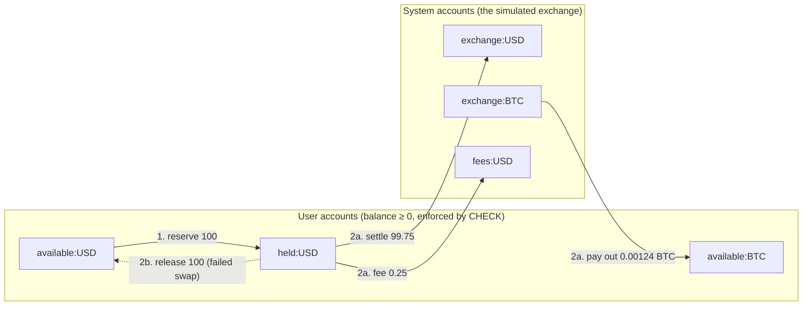
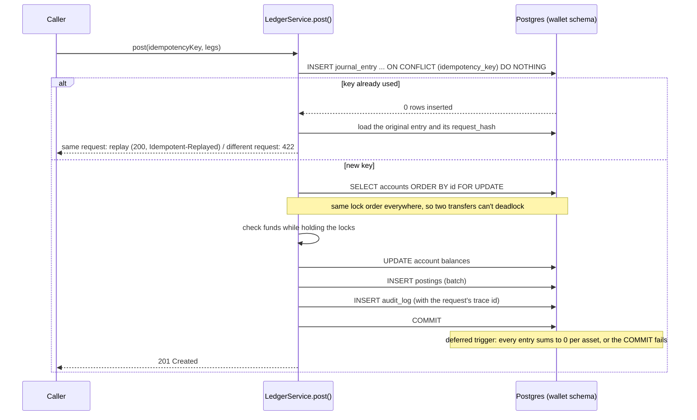
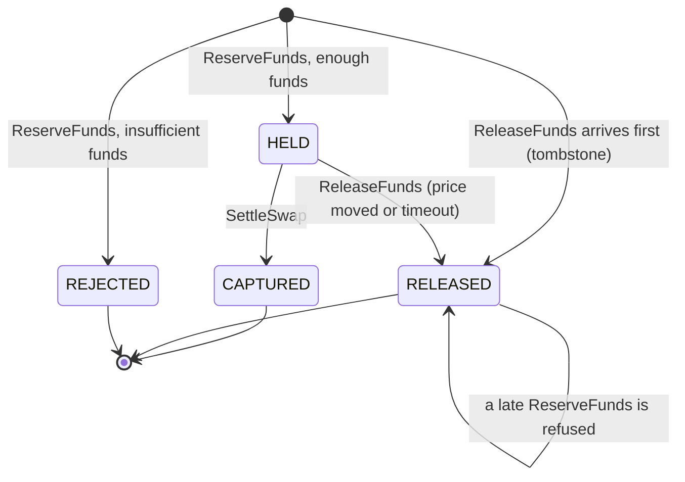

# 3. Double-entry ledger & simulated wallet

## The problem

The naive wallet is a `balance` column you `UPDATE`. It breaks in every way that matters for money:

- **Lost updates.** Two requests read balance 100, both subtract 80, both write 20. You just let a
  user spend 160 out of 100.
- **Double processing.** A client times out and retries a deposit; the server had already applied
  it. The user is credited twice.
- **No history.** When a balance is wrong, you can't tell *why*: the number was overwritten.
- **Silent corruption.** A bug that adds money somewhere without taking it from somewhere else
  goes unnoticed until the books don't add up.

## Options

| Concern | Naive | Robust |
|---|---|---|
| Balance model | mutable column | **double-entry journal**; balance is derived/maintained alongside |
| Concurrency | none / optimistic retry loops | **pessimistic row locks in a fixed order** |
| Retries | hope | **idempotency keys** stored with the result |
| Invariants | app code checks | **database constraints** + app checks |
| Detection | none | **reconciliation job** + metric + alert |

## What we did

**Double-entry.** Every change is a `journal_entry` with ≥ 2 `posting`s whose amounts sum to zero
*per asset*. Money never appears or disappears; it moves between accounts. A swap of 100 USD → BTC
is one entry:

```text
user:alice:held:USD      -100.00     (spend from funds held for this swap)
system:fees:USD            +0.25     (0.25% fee)
system:exchange:USD       +99.75
system:exchange:BTC   -0.00124064    (the simulated counterparty pays out)
user:alice:available:BTC +0.00124064
```

**The database enforces the rules** ([V1__ledger_schema.sql](../../services/wallet-service/src/main/resources/db/migration/V1__ledger_schema.sql)):

| Invariant | Mechanism |
|---|---|
| Entry sums to zero per asset | `DEFERRABLE INITIALLY DEFERRED` constraint trigger, checked at COMMIT |
| User balances ≥ 0 | `CHECK (allow_negative OR balance >= 0)` |
| Posting asset = account asset | composite foreign key `(account_id, asset)` |
| History is immutable | triggers reject `UPDATE`/`DELETE` on journal, postings, audit |

The integration test `LedgerIT.databaseRejectsUnbalancedEntriesAndHistoryEdits` proves each one.
Even a buggy deploy or a hand-written SQL statement can't create money.

**Locking.** [`LedgerService.post()`](../../services/wallet-service/src/main/java/dev/opencrypto/walletservice/ledger/LedgerService.java)
locks every involved account with `SELECT ... FOR UPDATE ORDER BY id`. Ordering by id means two
transfers touching the same accounts always lock in the same order, so they can't deadlock.
Funds are checked **under the lock**, so check-then-act is safe. `LedgerIT.concurrentReservationsNeverOverspend`
fires 20 parallel 1,000 USD reservations at a 10,000 USD balance: exactly 10 succeed.

**Idempotency keys.** The entry insert is `INSERT ... ON CONFLICT (idempotency_key) DO NOTHING`.
If the key exists, we return the original entry (`Idempotent-Replayed: true`, HTTP 200 instead of
201). We also store a **hash of the request**; the same key with a *different* body is a client bug
and gets `422 IDEMPOTENCY_KEY_REUSED` rather than silently returning the wrong thing. Deposits and
swap executions *require* the `Idempotency-Key` header.

**Holds instead of "check later".** For swaps, money first moves `AVAILABLE → HELD` (its own
ledger accounts), then `HELD → exchange` on settlement, or back on failure. Funds in flight are
visible and can't be double-spent ([chapter 4](04-swap-saga.md)).

**Profit/loss with average cost.** A `position` table tracks quantity and cost basis per asset,
updated in the same transaction as the ledger entry. Buying adds cost; selling removes cost at the
average price and books *realised* P/L. Fees show up as a realised loss.
Unrealised P/L = market value − remaining cost basis.

**Audit log.** Append-only `audit_log` rows record who/what/when with the **correlation id** of
the request, so any balance change can be traced to the HTTP call and logs that caused it.

**Reconciliation.** [`ReconciliationJob`](../../services/wallet-service/src/main/java/dev/opencrypto/walletservice/ledger/ReconciliationJob.java)
runs every 5 minutes in a `REPEATABLE READ` snapshot and checks:
1. every account's stored balance = sum of its postings;
2. every asset sums to zero across all accounts;
3. every user's HELD balance = their open reservations.
Mismatches are stored, logged at ERROR and exported as `ledger_reconciliation_mismatches`, which
fires the `LedgerReconciliationMismatch` alert.

## Diagrams

**How money moves in a swap.** User accounts can never go below zero; system accounts are the
simulated counterparty. Every arrow is a pair of postings that sums to zero.



**Posting one entry**: idempotency first, then locks in a fixed order, then the database checks the
invariants at commit.



**A reservation's life** (one row per swap, keyed by swap id).



## See it yourself

```bash
H='-H X-Demo-User:alice -H Content-Type:application/json'
curl $H -H 'Idempotency-Key: try-it-00001' -X POST localhost:8080/api/v1/wallet/deposits -d '{"symbol":"BTC","amount":"0.01"}' -i | grep -E 'HTTP|Replayed'
curl $H -H 'Idempotency-Key: try-it-00001' -X POST localhost:8080/api/v1/wallet/deposits -d '{"symbol":"BTC","amount":"0.01"}' -i | grep -E 'HTTP|Replayed'   # 200, replayed
curl $H 'localhost:8080/api/v1/wallet/ledger?size=3'
curl -X POST localhost:8080/api/v1/wallet/reconciliation/run
# Try to cheat the database directly (all fail):
docker compose exec postgres sh -c 'PGPASSWORD=wallet_localdev psql -h $(hostname -i) -U wallet_svc -d opencrypto -c "UPDATE posting SET amount = amount * 2"'
```

## Pitfalls

- **Catching an exception inside a transaction doesn't undo "rollback-only".** If `post()` throws
  `InsufficientFunds` through a `@Transactional` proxy, Spring marks the *outer* transaction
  rollback-only even if you catch it. `reserve()` therefore checks funds under a lock first and
  turns a shortfall into a normal "rejected" reply.
- **Never call another service inside a DB transaction.** Deposits fetch the price *before*
  opening the transaction ([chapter 6](06-resilience.md)).
- **`double` for money** loses cents. Everything is `BigDecimal` / `NUMERIC(38,18)`.

## Interview questions

- Explain double-entry bookkeeping and why it catches bugs a single balance column can't.
- How do you prevent two concurrent withdrawals from overspending? Why lock in id order?
- Design an idempotent POST endpoint. What do you return on a replay? On key reuse with a different body?
- Why enforce invariants in the database if the application already checks them?
- What does a reconciliation job check, and what do you do when it finds a mismatch?
