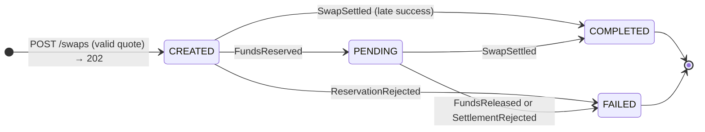
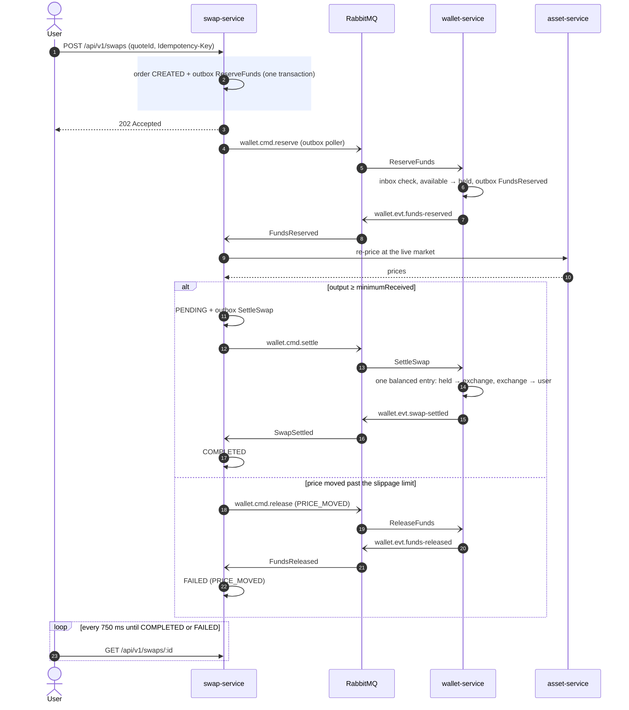
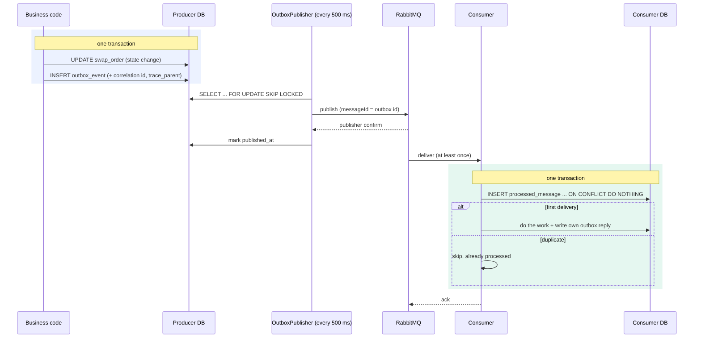
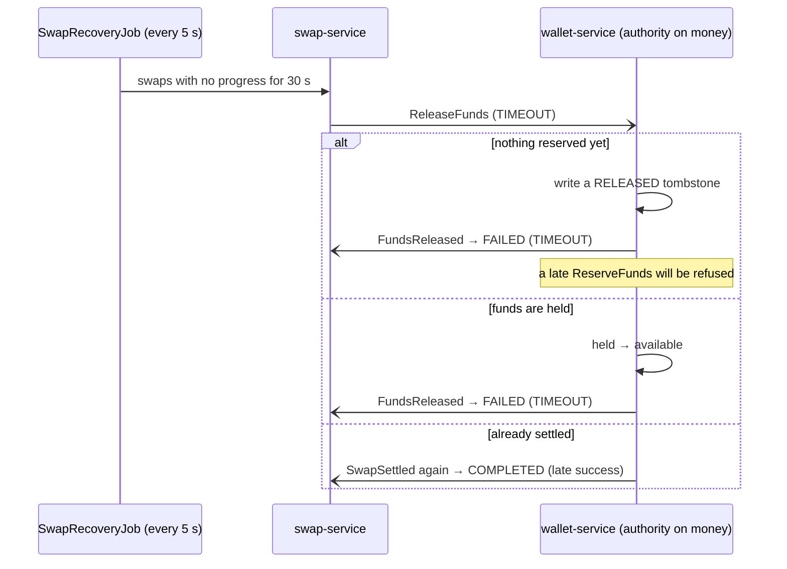
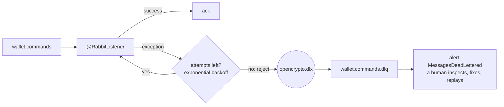

# 4. Reliable swap workflow (saga, outbox, retries, recovery)

## The problem

A swap touches two services: swap-service (the order) and wallet-service (the money). There's no
shared transaction across them. Naive approaches all lose money or consistency:

- **HTTP call inside a DB transaction.** swap-service saves the order, calls the wallet, the call
  times out *after* the wallet debited… did it succeed? You retry and debit twice, or give up and
  show "failed" while the money moved.
- **"Save, then publish an event."** The DB commit succeeds, the process crashes before
  `rabbitTemplate.send()`. The event is lost forever. Or you publish first and the commit fails:
  an event for something that never happened.
- **At-least-once delivery.** RabbitMQ (and any broker) can deliver a message twice. A naive
  consumer settles a swap twice.
- **Timeouts.** "No answer after 30 s → mark FAILED" is wrong if the wallet actually settled.

## Options

| Approach | Verdict |
|---|---|
| Two-phase commit (XA) across services | heavy, poorly supported, couples availability |
| Choreography (services react to each other's events) | loosely coupled, but the flow is hard to see and debug |
| **Orchestrated saga** (one service drives the steps) | explicit state machine in one place, easy to reason about |

## What we did

**An orchestrated saga with an explicit state machine.** swap-service owns the flow
([`SwapService`](../../services/swap-service/src/main/java/dev/opencrypto/swapservice/domain/SwapService.java)),
wallet-service executes money steps:

```text
POST /swaps ─► CREATED ──ReserveFunds──► wallet ──FundsReserved──► PENDING ──SettleSwap──► wallet ──SwapSettled──► COMPLETED
                  │                         └──ReservationRejected──► FAILED          └──SettlementRejected──► FAILED
                  └── price moved / market down / timeout ──ReleaseFunds──► wallet ──FundsReleased──► FAILED
```

Allowed transitions are coded in `SwapModels.State` (terminal states never change), and every
transition is recorded in `swap_state_history` with the correlation id.

**`POST /swaps` returns 202 Accepted.** The HTTP request only records the order and queues the
first command; the UI polls `GET /swaps/{id}` and shows a live stepper.

**Transactional outbox.** Commands and events are inserted into an `outbox_event` table **in the
same DB transaction** as the state change ([`OutboxWriter`](../../libs/platform-common/src/main/java/dev/opencrypto/platform/messaging/OutboxWriter.java)).
A poller ([`OutboxPublisher`](../../libs/platform-common/src/main/java/dev/opencrypto/platform/messaging/OutboxPublisher.java))
publishes rows with **publisher confirms** and marks them sent. Rows are claimed with
`FOR UPDATE SKIP LOCKED`, so multiple instances never publish the same row concurrently. Either the
state change and the message both happen, or neither does. Delivery is *at least once*.

**Idempotent consumers (inbox).** Every message has a stable `messageId` (the outbox row id).
Consumers insert it into `processed_message` in the same transaction as their work; a duplicate
gets `ON CONFLICT DO NOTHING` and is skipped ([`InboxGuard`](../../libs/platform-common/src/main/java/dev/opencrypto/platform/messaging/InboxGuard.java)).
On top of that, every wallet step is idempotent **by swap id** (`reserve:{id}`, `settle:{id}` keys).

**Retries and dead-letter queues.** Listener failures are retried with exponential backoff
(`spring.rabbitmq.listener.simple.retry.*`). After the budget is exhausted the message is rejected
into `<queue>.dlq` (every queue is declared with a dead-letter exchange in
[`Messaging.queueWithDeadLetter`](../../libs/platform-common/src/main/java/dev/opencrypto/platform/messaging/Messaging.java)),
and the `MessagesDeadLettered` alert fires. Nothing is silently dropped or retried forever.

**Slippage protection at execution.** After funds are reserved, swap-service re-prices at the live
market. If the output would fall below the quote's `minimumReceived`, it doesn't settle: it asks
the wallet to release the hold (`PRICE_MOVED`).

**Timeouts ask the authority instead of guessing.** [`SwapRecoveryJob`](../../services/swap-service/src/main/java/dev/opencrypto/swapservice/saga/SwapRecoveryJob.java)
finds swaps with no progress for 30 s and sends `ReleaseFunds`. The **wallet decides** the outcome:

| Wallet state when ReleaseFunds arrives | Reply | Swap ends |
|---|---|---|
| nothing reserved yet | records a RELEASED *tombstone*, `FundsReleased` | FAILED (TIMEOUT); a late Reserve is refused |
| funds held | releases them, `FundsReleased` | FAILED (TIMEOUT) |
| already settled | `SwapSettled` again | **COMPLETED** (the late success is the truth) |

A swap is only marked FAILED once the wallet confirms the money is back. "Failed but money moved"
can't happen.

**Reads stay consistent eventually.** transaction-service consumes `swap.evt.state-changed` and
upserts the activity feed with a "newer wins" guard (`WHERE activity.updated_at <= EXCLUDED.updated_at`),
so an out-of-order PENDING can't overwrite COMPLETED.

## Diagrams

**The swap state machine** (`SwapModels.State`). Terminal states never change.



**Happy path and "price moved"**, end to end.



**Transactional outbox + idempotent consumer.** The two shaded boxes are the only transactions;
nothing is ever "half done".



**Timeouts ask the authority.** The swap service never guesses the outcome; the wallet answers with the truth.



**Retries and dead letters.** Nothing is dropped silently and nothing retries forever.



## See it yourself: crash the wallet mid-swap

```bash
# 1. stop wallet-service (Ctrl+C its process, or kill the PID in .run/wallet-service.pid)
# 2. submit a swap from the UI or API; it stays CREATED (commands wait in RabbitMQ: http://localhost:15673/#/queues)
# 3. after 30 s the recovery job requests a release (state history shows it)
# 4. restart the wallet (SKIP_BUILD=1 scripts/run-local.sh); it processes Reserve, then Release
# 5. the swap ends FAILED(TIMEOUT), funds are back in AVAILABLE, reconciliation is OK
```

`SwapSagaIT` scripts all branches against real RabbitMQ and Postgres: happy path, rejection,
price moved, timeout → late success, and duplicate delivery.

## Pitfalls

- **No network calls inside the listener's transaction.** Re-pricing happens *before*
  `tx.execute(...)`, then a short transaction applies the result.
- **Make every step idempotent**, not just the consumer: retries can come from your own recovery job.
- **New read models miss old events.** transaction-service only sees events published after its
  queue existed; a real system needs a replay/backfill ([chapter 10](10-bugs-and-lessons.md)).

## Interview questions

- What is the transactional outbox pattern and what problem does it solve?
- At-least-once vs exactly-once: how do you get exactly-once *effects*?
- Orchestration vs choreography: when would you pick each?
- A downstream call times out. Did it happen? How do you design so it doesn't matter?
- What goes in a dead-letter queue and what do you do with it?
