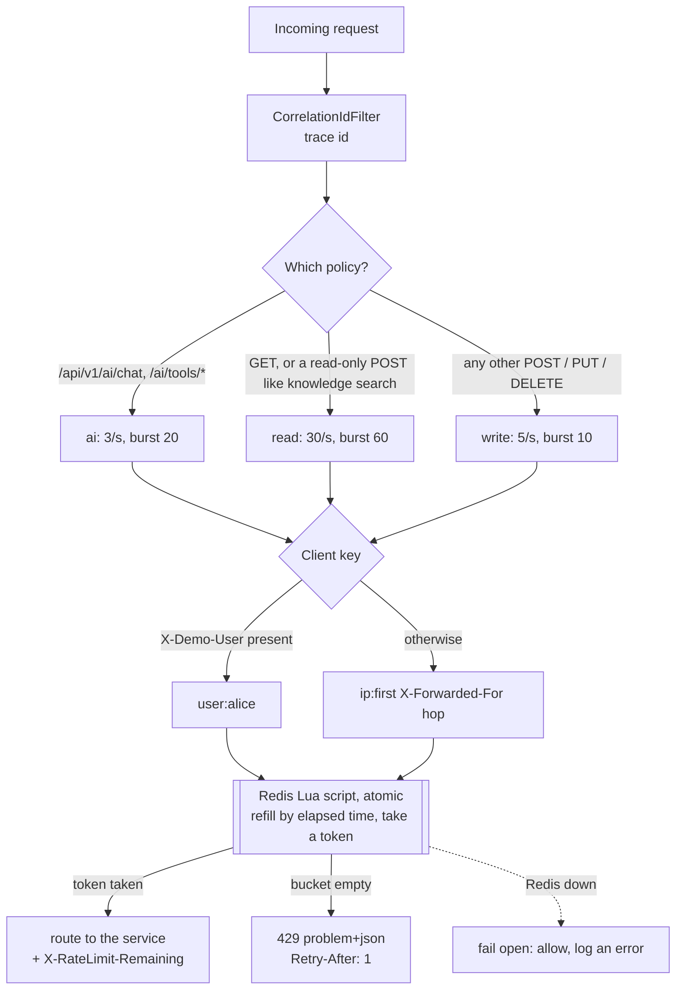
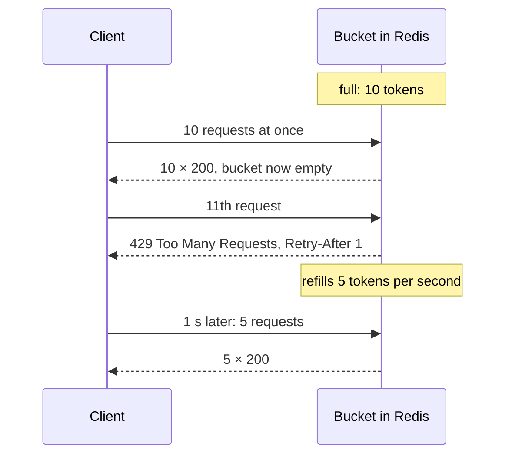

# 5. Rate limiting at the gateway

## The problem

Without limits, one client (a bug in a retry loop, a scraper, an attacker) can:

- exhaust database connections and starve everyone else,
- burn your third-party and LLM budgets,
- spam money-moving endpoints faster than any human could.

Limits must hold **across all gateway instances**, be **fair per client**, and tell well-behaved
clients how to back off.

## Options

| Algorithm | Behaviour |
|---|---|
| Fixed window ("100 per minute") | simple; allows 2× bursts at window edges |
| Sliding window log | exact; memory per request |
| **Token bucket** | steady rate + controlled bursts; O(1) state per client |
| Leaky bucket | smooths output; queues requests |

Where to store state: in-memory (per instance, wrong when scaled out) vs **Redis** (shared, atomic).

## What we did

**Token bucket in Redis, enforced at the edge.** [`RateLimitFilter`](../../services/api-gateway/src/main/java/dev/opencrypto/apigateway/RateLimitFilter.java)
is a gateway `GlobalFilter` using Spring Cloud Gateway's `RedisRateLimiter`, which runs an
**atomic Lua script** in Redis: refill tokens by elapsed time × rate, take one, return the
remainder. Every gateway instance shares the same buckets.

**Per-client keys.** `user:<X-Demo-User>` when present (validated against a strict pattern),
otherwise `ip:<first X-Forwarded-For hop or remote address>`. One noisy client can't use up
another's budget.

**Policies follow cost, not HTTP verb.**

| Policy | Applies to | Default |
|---|---|---|
| read | GETs and read-only POSTs (knowledge search) | 30 req/s, burst 60 |
| write | quotes, swaps, deposits, simulation controls | 5 req/s, burst 10 |
| ai | `/api/v1/ai/chat`, tool calls (will call a paid LLM) | 3 req/s, burst 20 |

All are configurable (`RATELIMIT_*` env vars). Rates below 1/s are expressed with
`tokens-per-request` > replenish rate (e.g. refill 1, cost 60 = one request a minute).

**A good 429.** Rejections return RFC 7807 JSON with `code: RATE_LIMITED`, the correlation id and
`Retry-After: 1`. Every response carries `X-RateLimit-Remaining`, `-Burst-Capacity` and
`-Replenish-Rate`, so clients can slow down *before* hitting the wall. The UI shows a friendly
toast; the eval scripts sleep for `Retry-After` and retry.

**Fail open.** If Redis is down, `RedisRateLimiter` allows the request and logs an error. For
this product, availability beats strict limiting; a bank's payment API might choose fail-closed.

**Observable.** `gateway_ratelimit_rejected_total{policy}` is on the Grafana dashboard; the
`RateLimitingSpike` alert fires on sustained rejections.

## Diagrams

**The decision for every request** ([`RateLimitFilter`](../../services/api-gateway/src/main/java/dev/opencrypto/apigateway/RateLimitFilter.java)).



**A token bucket over time** (write policy: burst 10, refill 5 per second).



## See it yourself

```bash
for i in $(seq 1 20); do curl -s -o /dev/null -w "%{http_code}\n" -X POST -H 'X-Demo-User: burst' \
  -H 'Content-Type: application/json' localhost:8080/api/v1/swaps/quotes \
  -d '{"fromSymbol":"USD","toSymbol":"BTC","amount":"10"}' & done | sort | uniq -c   # ~10-15 × 200, the rest 429
docker compose exec redis redis-cli --scan --pattern 'request_rate_limiter*'
```

## Pitfalls

- **Classifying by verb.** Knowledge search is a POST but only reads; it ended up on the strict
  write limit and broke the eval script until policies were made cost-based ([chapter 10](10-bugs-and-lessons.md)).
- **Trusting `X-Forwarded-For` blindly.** Only trust it behind your own proxy (nginx in Compose).
- **Timing-dependent tests.** A slow upstream refills the bucket between requests; the test uses a
  one-request-per-minute refill so it is deterministic.

## Interview questions

- Compare fixed window, sliding window and token bucket.
- Why must the check-and-decrement be atomic, and how does a Lua script give you that?
- Fail-open or fail-closed when the limiter's store is down? Justify for this product.
- How do you rate-limit fairly when many users share one IP (corporate NAT)?

> Why not exactly 10 × 200? The burst is 10, but the bucket also refills 5 tokens per second while
> the shell is still launching requests, so a few more get through. `RateLimitIT` measures the exact
> behaviour with a refill slow enough to make the result deterministic.
