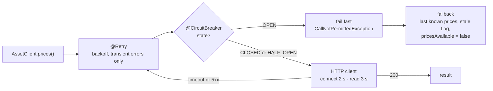
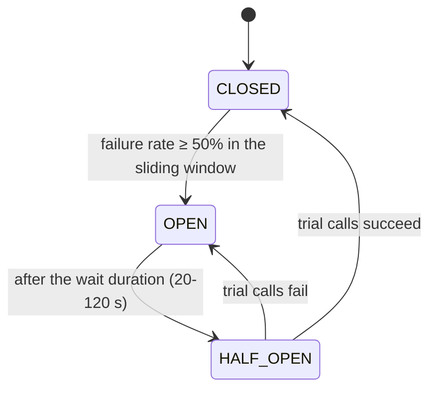
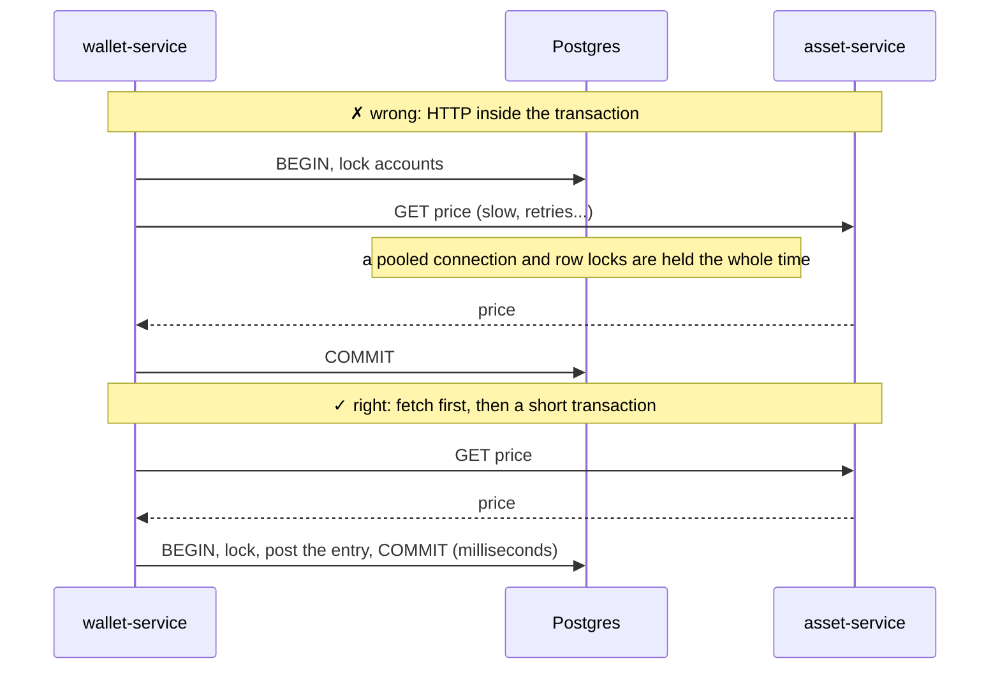

# 6. Resilience: timeouts, retries, circuit breakers

## The problem

Every network call can be slow, fail, or hang forever. Without protection:

- A hung dependency holds a thread (and maybe a DB connection) per request until the pool is empty,
  and then *your* service is down too: a **cascading failure**.
- Naive retries multiply load on a struggling dependency (a **retry storm**).
- One flaky third party (CoinGecko) makes your whole product look broken.

## The toolkit, in the order a call goes through it

| Tool | Question it answers | Where |
|---|---|---|
| **Timeout** | How long do I wait? | every HTTP client: connect 2-3 s, read 3-10 s; gateway response timeout 15 s |
| **Retry with exponential backoff** | Was it a blip? | `resilience4j.retry.instances.*`: 2-3 attempts, only for transient errors (timeouts, 5xx, 429) |
| **Circuit breaker** | Is it down? Stop calling for a while. | `resilience4j.circuitbreaker.instances.*`: opens at 50% failures, half-opens after 20-120 s |
| **Fallback / degradation** | What do I show instead? | last known prices flagged `stale`; portfolio with `pricesAvailable=false` |

Retry is the *outer* wrapper and circuit breaker the inner one, so each attempt counts toward the
breaker and an open breaker fails retries fast.

## Diagrams

**What one protected call goes through.**



**Circuit breaker states.**



**Why no network calls inside a database transaction.**



## What we did

- **CoinGecko** ([`CoinGeckoClient`](../../services/asset-service/src/main/java/dev/opencrypto/assetservice/market/coingecko/CoinGeckoClient.java)):
  JDK HTTP client with timeouts, `@Retry` + `@CircuitBreaker`. When the breaker is open the sync
  job records "Circuit breaker open" and users keep seeing the last good prices, marked stale.
  `MarketDataIT` scripts CoinGecko with WireMock returning 429s and asserts: retries happen, the
  breaker opens, and later syncs **don't call CoinGecko at all**.
- **Service-to-service calls** (wallet/swap → asset-service) use the same pattern (`assetService`
  instances). 4xx responses are *ignored* by the breaker: a 404 for an unknown asset means the
  dependency is healthy.
- **Degrade, don't die.** If asset-service is down, the portfolio still loads with balances and a
  "prices unavailable" banner; swaps fail fast with `MARKET_UNAVAILABLE` instead of hanging.
- **Redis is optional at read time.** The price cache falls back to Postgres; the rate limiter
  fails open.
- **No network I/O inside database transactions.** A transaction that waits on HTTP holds a pooled
  connection and row locks for the whole call (and its retries). Deposits fetch the price first,
  then open a short transaction; the saga listener re-prices first, then runs
  `tx.executeWithoutResult(...)`.
- **Graceful shutdown** (`server.shutdown: graceful`) finishes in-flight requests on redeploys.
- **Visible state.** Breaker states are exported (`resilience4j_circuitbreaker_state`), shown on
  the Status page, included in `/actuator/health`, and alerted on (`CircuitBreakerOpen`).

## See it yourself

```bash
# Point CoinGecko at a dead address and watch the breaker open on the Status page:
#   COINGECKO_BASE_URL=http://localhost:1 SKIP_BUILD=1 scripts/run-local.sh   (restart asset-service)
curl localhost:8080/api/v1/market/status | python -m json.tool
# Stop asset-service: the portfolio still loads, flagged pricesAvailable=false
```

## Pitfalls

- **Retrying non-idempotent calls.** Only retry what is safe to repeat; our retried calls are GETs
  or idempotent by key.
- **Timeouts longer than the caller's timeout.** The gateway waits 15 s, services 3-10 s, so the
  inner timeout always fires first and returns a clean error.
- **Annotations need a proxy.** `@Retry`/`@CircuitBreaker` only work when the method is called
  from *another* bean (Spring AOP).

## Interview questions

- What's a cascading failure and which patterns stop it?
- Why exponential backoff (with jitter in production) instead of immediate retries?
- Explain the circuit breaker states (closed, open, half-open).
- Why is calling an HTTP API inside a DB transaction dangerous?
