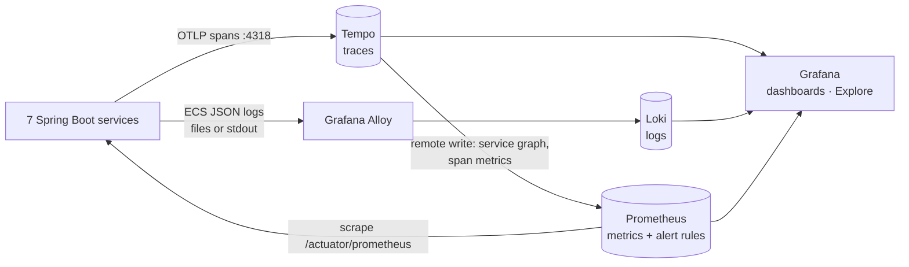
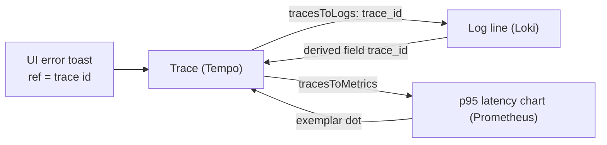
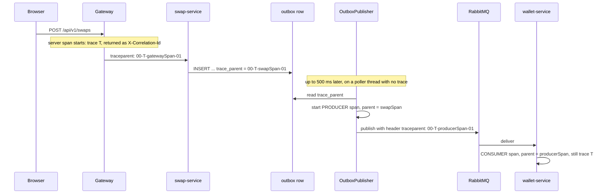

# 7. Observability: tracing, logs, metrics, alerts

## The problem

A user says "my swap failed". The swap touched the gateway, swap-service, RabbitMQ, wallet-service
and transaction-service. Without observability you grep seven log files by timestamp and guess.
And you only learn about a broken ledger when a customer complains.

The three questions to answer quickly: **What happened to this request?** (tracing/correlation)
**Is the system healthy right now?** (metrics) **Will someone notice when it isn't?** (alerts)

## What we did

**Correlation IDs end to end.** (Since the tracing upgrade below, the correlation id *is* the W3C
trace id: one id finds the logs, the trace and the database rows.)
- The gateway sets `X-Correlation-Id` to the request's trace id (or keeps a well-formed one from the
  client) and returns it on every response ([`CorrelationIdFilter`](../../services/api-gateway/src/main/java/dev/opencrypto/apigateway/CorrelationIdFilter.java)).
- Each service puts it in the logging MDC, so **every log line** includes it
  ([`platform-common`](../../libs/platform-common/src/main/java/dev/opencrypto/platform/web/CorrelationIdFilter.java)).
- Outgoing HTTP calls forward it (a `RestClientCustomizer` adds it to every `RestClient` built from
  Spring's builder).
- **Across RabbitMQ**: the outbox row stores the id; the publisher sets a message header; the
  consumer restores it into the MDC. A saga that runs for 30 s across three services still logs
  under one id.
- It's stored in the **audit log** and **swap state history**, and shown in **error responses and
  UI toasts** ("ref 3fa8…"), so a user can quote it.
- Incoming ids are validated (`[A-Za-z0-9._-]{1,64}`) because they end up in logs (log injection).

**Structured logs.** Spring Boot 3.4's built-in structured logging writes Elastic Common Schema
(ECS) JSON: one object per line with `@timestamp`, `log.level`, `service.name`, `log.logger`,
`message`, `error.stack_trace` and every MDC entry, including `correlationId`. In Docker the
`json-logs` profile writes it to stdout. On the host the run scripts keep readable text on the
console (`.run/logs/<svc>.log`) and also write JSON to `.run/logs/json/<svc>.json`
(`LOGGING_FILE_NAME` + `LOGGING_STRUCTURED_FORMAT_FILE=ecs`), so you don't have to choose.

**Centralised logs in Grafana (Loki + Alloy).** `grep` works for one laptop. In production you
have many instances that come and go, so logs must be shipped to one searchable place.

```text
services ──JSON──► .run/logs/json/*.json (host)  ┐
                   container stdout (docker)      ├─► Grafana Alloy ──► Loki ──► Grafana "OpenCrypto logs"
                                                  ┘   parse JSON, set labels,    store + LogQL
                                                      timestamp from the log
```

- [**Alloy**](../../infra/observability/alloy/config.alloy) tails the files (host mode) or
  discovers containers through the Docker socket (Docker mode), parses each JSON line, and pushes
  it to Loki. Its pipeline graph is at http://localhost:12345. (Promtail, the older shipper, has
  reached end of life; Alloy replaces it.)
- [**Loki**](../../infra/observability/loki/loki.yml) stores the lines. Like Prometheus, it indexes
  only **labels**, so labels must have few values: `service` (7) and `level` (5). The
  `correlation_id` has a new value per request, which would explode the index. It's stored as
  **structured metadata** instead: attached to each line and filterable, but not indexed.
- **Log JSON fields, not sentences.** Access-log lines carry `http.request.method`, `url.path`,
  `http.response.status_code` and `duration_ms` as separate JSON fields (SLF4J key-value pairs,
  see [`AccessLog`](../../libs/platform-common/src/main/java/dev/opencrypto/platform/web/AccessLog.java)).
  Dashboards can then filter `status >= 400` or compute p95 latency from logs, with no regex
  parsing of the message text.

**Presenting logs: one dashboard per question.** A raw stream of every line answers nothing; you
scroll until you get lucky. The log dashboards (generated by
[`logs_dashboard.py`](../../infra/observability/grafana/logs_dashboard.py), provisioned from files)
follow the order you investigate in:

| Dashboard | Question | What's on it |
|---|---|---|
| **OpenCrypto logs** | *Is something wrong? Where?* | Tiles: errors, warnings, failed requests, p95 request time. Charts: volume by level, errors/warnings by service. Tables: **errors and warnings** and **failed or slow requests** (status, duration, path). Recent logs, newest first. Filters: service, level, text, health checks hidden by default. |
| **Request trace** | *What happened to this one request?* | **Recent requests** list from Tempo (filter: failed, slow, path; click to pick one). Tiles: HTTP status, response time, services involved, warnings. The request's **timeline** across every service, oldest first. |

Every correlation id in a table, and in any log line's details in Explore, is a link: **click it
and you're in the request trace.** So the flow is: notice red on a tile → find the row in a table
→ click its id → read the story.

Presentation choices worth copying:
- **Colour means severity, nothing else.** Red is ERROR or 5xx, orange is WARN, 4xx or slow,
  green is healthy. The same mapping is used on every panel.
- **Hide expected noise by default.** Health checks poll every few seconds; they're hidden, but
  one click shows them again. Never delete noise at the source just to make a chart look clean.
- **Short and aligned beats complete.** Lines show `swap` instead of `swap-service`, padded so the
  messages line up; full fields are one click away in the line's details.
- **Show the outcome first.** The trace's first tile is the HTTP status. A green 202 above an
  orange "1 warning" teaches the most important lesson of async systems: *accepted* is not
  *succeeded*.

LogQL you'll use (Grafana → Explore → Loki):

```logql
{service="swap-service", level="ERROR"}                         # all errors from one service
{service=~".+"} | correlation_id="5aebb9c9-…"                    # one request, every service
{level=~"ERROR|WARN"} |= "INSUFFICIENT_FUNDS"                     # text search
sum by (service) (count_over_time({level="ERROR"}[5m]))          # error rate from logs
```

**Metrics with Micrometer → Prometheus.** Every service exposes `/actuator/prometheus`:
- **RED** per service: request rate, errors, duration histograms (`http_server_requests_seconds_*`).
- **Business**: `swap_orders_total{result,reason}`, `ledger_entries_total{result}`,
  `swap_timeouts_total`, `swap_quotes_total{pair}`.
- **Reliability**: `outbox_pending`, `ledger_reconciliation_mismatches`, `market_price_age_seconds`,
  `price_cache_requests_total{result}`, `resilience4j_circuitbreaker_state`,
  `gateway_ratelimit_rejected_total{policy}`, RabbitMQ per-queue depth (incl. DLQs).

**Dashboards as code.** [`generate_dashboard.py`](../../infra/observability/grafana/generate_dashboard.py)
generates the Grafana JSON; Grafana is **provisioned** from files (datasource + dashboard), so a
fresh `docker compose up` shows the dashboard with no clicking.

**Alerts on symptoms that matter** ([alerts.yml](../../infra/observability/prometheus/alerts.yml)):
`LedgerReconciliationMismatch` (critical), `SwapStateInconsistency`, `OutboxBacklog`,
`MessagesDeadLettered`, `CircuitBreakerOpen`, `MarketDataStale`, `HighServerErrorRate`,
`RateLimitingSpike`. Each annotation says what it means and what to do.

**Health checks** with details (db, redis, rabbit, circuit breakers) per service, surfaced on the
UI's Status page through read-only gateway routes.

## See it yourself

```bash
curl -s -D - -o /dev/null localhost:8080/api/v1/portfolio -H 'X-Demo-User: alice' | grep -i correlation
grep <that-id> .run/logs/*.log          # the same id in gateway, wallet and asset-service logs
open http://localhost:3000/d/opencrypto-overview   # Grafana metrics (anonymous viewer enabled locally)
open http://localhost:3000/d/opencrypto-logs      # Grafana logs: errors, failed requests, recent lines
open "http://localhost:3000/d/opencrypto-request?var-correlation_id=<that-id>"   # that request, every service
open http://localhost:9090/alerts                  # Prometheus alert rules
```

## Diagrams

**Where the three signals go.**



**How the signals link to each other**, so you never copy-paste ids between tools.



## Worked example: tracing a failed swap

A user reports "my swap failed". Their swap crossed four services and RabbitMQ. Here's how you find
out why in under a minute.

**1. Get the correlation id.** The user has it: the error toast shows `ref c7cb5f15…`, and every API
response has an `X-Correlation-Id` header and a `correlationId` field in error bodies. Support can also
find it from the swap itself: `GET /api/v1/swaps/{id}` returns `stateHistory[].correlationId`.

**2. Search every log for it.**

```bash
grep -h c7cb5f15-0ee7-4106-ac48-2511bd91a567 .run/logs/*.log | sort
```

```text
16:17:52.683 swap-service        Queued ReserveFunds (wallet.cmd.reserve) for swap ec6f24e2…
16:17:52.706 swap-service        POST /api/v1/swaps -> 202 in 53 ms
16:17:52.710 api-gateway         POST /api/v1/swaps -> 202 in 65 ms
16:17:53.195 wallet-service      Received wallet.cmd.reserve on wallet.commands
16:17:53.224 wallet-service      Queued ReservationRejected (wallet.evt.reservation-rejected) for swap ec6f24e2…
16:17:53.397 swap-service        Received wallet.evt.reservation-rejected on swap.wallet-events
16:17:53.415 swap-service        Swap ec6f24e2… CREATED -> FAILED: Reservation rejected: Available 1000 USD, required 9000
16:17:53.424 WARN swap-service   Swap ec6f24e2… FAILED: INSUFFICIENT_FUNDS
16:17:53.762 transaction-service Received swap.evt.state-changed on txn.activity
```

**3. Read the story.** The HTTP request finished in 65 ms with 202; the failure happened *a second
later, in another service, triggered by a message*. Without the id travelling inside the message
you'd only find the 202 and conclude nothing went wrong.

**4. Follow it into the data.** The same id is on the wallet's `audit_log` rows and the swap's
`swap_state_history`, so you can join logs to database records:
`SELECT * FROM wallet.audit_log WHERE correlation_id = '…'`.

**5. Or do it in Grafana**, which is how you'd do it in production. On **OpenCrypto logs** the
failed swap's WARN is in the "Errors and warnings" table; click its correlation id (or open
`http://localhost:3000/d/opencrypto-request?var-correlation_id=<id>`). The **Request trace** shows
HTTP 202 in 116 ms, 4 services involved, 1 warning, then the same timeline from all services,
with levels coloured and stack traces expandable. You never log in to a server.
The query behind it is `{service=~".+"} | correlation_id="<id>"`. In Kibana it would be
`correlationId:"<id>"`.

### What makes the trace complete

| Hop | Logged by |
|---|---|
| HTTP in, every service | `http.access` line from the correlation filter (method, path, status, ms) |
| Message written to outbox | `messaging.outbound`: "Queued {type} ({routing key}) for {aggregate}" |
| Message consumed | `messaging.inbound`: "Received {routing key} on {queue}", plus "(redelivery)" on retries |
| Business state change | `SwapService`: "Swap {id} {from} -> {to}: {why}", WARN on FAILED |
| Unexpected exception | `ProblemDetailsAdvice` logs it at ERROR with the stack trace; the client gets the id |

**The rule: log at boundaries and state changes, not everywhere.** One line per hop is enough to
rebuild the timeline; the details live in the database tables the id points to.

## Pitfalls

- **High-cardinality labels** (user ids, swap ids) in metrics explode Prometheus memory. Labels
  here are bounded: result, reason, policy, pair.
- **Metrics with inconsistent labels are silently dropped.** `swap.orders` was registered with
  `{result}` in one place and `{result, reason}` in another; Prometheus rejects the second, so
  failed swaps were never counted and the dashboard and alerts were blind to them. Always use the
  same label keys for one metric name (we use `reason="none"`). We found this *by* tracing an
  error by its correlation id ([chapter 10](10-bugs-and-lessons.md) #16).
- **Duplicate headers.** Both the gateway and the service set `X-Correlation-Id`; the gateway now
  sets it in `beforeCommit` so the response carries exactly one.
- **Correlation id as a Loki label.** It looks convenient, but every request would create a new
  stream and the index would explode, the same problem as user ids in Prometheus. Use
  structured metadata (or a line filter) for high-cardinality values.
- **Don't parse plain-text logs with regexes.** Log JSON at the source; the shipper then only
  maps fields. Changing a log pattern can't silently break your parsing.
- **Reactive code loses the MDC.** The gateway (WebFlux) hops threads, so the correlation id is
  put into the MDC just for the log call; otherwise its JSON lines would have no `correlationId`.
- **Alert fatigue.** Alert on user-visible symptoms and invariants, not on every log error.

## Distributed tracing: W3C Trace Context + OpenTelemetry

### The problem with a home-made correlation id

Correlation ids answer *which* lines belong together, but not **where the time went**. A swap takes
3 seconds. Is it the database? A slow service? RabbitMQ? Logs only have the moment each line was
written, not how long each operation took or who called whom. And a custom `X-Correlation-Id` header
is understood by nobody else: not by load balancers, not by cloud services, not by other teams' tools.

### The standard

| Piece | Standard | What it is |
|---|---|---|
| Propagation | [W3C Trace Context](https://www.w3.org/TR/trace-context/) | `traceparent: 00-<trace id>-<parent span id>-<flags>` on every HTTP call and message |
| Data model + API | [OpenTelemetry](https://opentelemetry.io/) | A **trace** is a tree of **spans**: one timed operation each (HTTP server, HTTP client, publish, receive), with attributes named by the OTel *semantic conventions* (`http.request.method`, `messaging.system`...) |
| Export | OTLP | The vendor-neutral protocol. Tempo here; Jaeger, Datadog, Honeycomb, AWS X-Ray all accept it |

### What we did

```text
browser ─► gateway ──traceparent──► swap-service ──outbox──► publish span ──traceparent header──► wallet consumer span ─► ...
            │ server span            │ server span            (parent = context saved in the row)
            └─────────── all spans ──► OTLP :4318 ──► Tempo ──► Grafana (trace view, service map, links to logs/metrics)
```

- **Spring Boot's Micrometer Tracing with the OpenTelemetry bridge** in every service (declared once
  in `platform-common`, defaults in [`TracingDefaults`](../../libs/platform-common/src/main/java/dev/opencrypto/platform/tracing/TracingDefaults.java)).
  Incoming `traceparent` is honoured, server spans are created per request, and every `RestClient`
  built from Spring's builder and the gateway's proxy client inject `traceparent` downstream. No
  hand-written header code for HTTP.
- **The trace survives the outbox.** This is the part most tutorials miss. The outbox poller publishes
  *later*, on another thread, so a naive setup starts a new trace (or none) for every message. We
  store the transaction's `traceparent` in the outbox row; the publisher starts a **PRODUCER span
  whose parent is that saved context** and puts its own `traceparent` into the message headers
  ([`OutboxPublisher`](../../libs/platform-common/src/main/java/dev/opencrypto/platform/messaging/OutboxPublisher.java),
  [`TraceContext`](../../libs/platform-common/src/main/java/dev/opencrypto/platform/tracing/TraceContext.java)).
  Listener observation is enabled, so each consumer continues the trace as a **CONSUMER span**. A
  whole swap (HTTP, 6 messages, a price lookup, 5 services) is **one trace**.
- **One id for humans and machines.** The gateway uses the **trace id as the correlation id**, so the
  "ref" a user reads from an error toast opens the trace directly. A client-supplied
  `X-Correlation-Id` is still honoured and added to the span as `correlation.id`.
- **Logs carry `traceId`/`spanId`** (MDC, set by Spring), Alloy stores them as Loki structured
  metadata, and the three signals link to each other in Grafana:

  | From | To | How |
  |---|---|---|
  | A log line | its trace | Loki derived field `trace_id` → "Open trace in Tempo" |
  | A span | its logs | Tempo `tracesToLogsV2` → `{service=~".+"} \| trace_id="…"` |
  | A latency chart | a slow request's trace | **exemplars**: dots on the p95 chart carry a trace id |
  | Everything | a service map | Tempo's metrics-generator turns spans into `traces_service_graph_*` metrics |

- **Noise control.** No spans for `/actuator` (Prometheus scrapes, health checks) or the outbox
  poller's 500 ms loop; otherwise the useful traces drown
  ([`TracingAutoConfiguration`](../../libs/platform-common/src/main/java/dev/opencrypto/platform/tracing/TracingAutoConfiguration.java)).
- **Sampling** is 100% locally. In production you'd sample: `MANAGEMENT_TRACING_SAMPLING_PROBABILITY=0.1`
  (head sampling), or better, tail sampling in an OpenTelemetry Collector that keeps *all* error and
  slow traces and a fraction of the rest.

**How one trace survives the outbox.** The publisher runs later, on another thread, with no trace
of its own; the saved `trace_parent` reconnects it.



### What a swap trace taught us immediately

```text
+    0.0ms   199.6ms  api-gateway          SERVER    http post
+   12.8ms   184.3ms  swap-service         SERVER    http post /api/v1/swaps
+  609.6ms    49.7ms  swap-service         PRODUCER  publish wallet.cmd.reserve       ← 400 ms after the commit
+  663.3ms   236.0ms  wallet-service       CONSUMER  wallet.commands receive
+ 1301.2ms    17.2ms  wallet-service       PRODUCER  publish wallet.evt.funds-reserved
+ 1330.3ms   328.2ms  swap-service         CONSUMER  swap.wallet-events receive
+ 1458.5ms    46.1ms  asset-service        SERVER    http get /api/v1/prices
   ... 19 spans, 5 services, 2,952 ms total
```

The real work is small; most of the 3 s is **gaps before each `publish`**: the outbox poll interval
(500 ms) paid on every hop. That's the price of the outbox's reliability, and now it's measured, not
guessed. Ways to cut it: a shorter poll interval, publish-after-commit with the poller as a safety
net, or change-data-capture (Debezium) instead of polling.

### See it yourself

```bash
# make a swap in the UI, copy the "ref" (or X-Correlation-Id): it's a 32-hex trace id
open "http://localhost:3000/d/opencrypto-request?var-correlation_id=<ref>"   # trace waterfall + logs
open http://localhost:3000/d/opencrypto-overview                              # scroll down: service map
curl -s localhost:3200/api/traces/<ref> | head -c 300                          # raw OTLP JSON from Tempo
```

### Database spans: every SQL statement inside its trace

#### The problem

The swap trace above says "wallet-service CONSUMER 236 ms" and stops there. Was that one slow
query? Five fast ones? Waiting for a row lock (the ledger locks accounts with `SELECT ... FOR UPDATE`)?
Waiting for a free connection from the pool? Without database spans, all of that is one opaque bar.

#### Options

| Option | How | Trade-off |
|---|---|---|
| `datasource-micrometer` | Wraps the DataSource; spans through Micrometer's Observation API | Fits Micrometer well, but its attribute names (`jdbc.query[0]`) are its own, not OpenTelemetry's |
| OpenTelemetry **Java agent** | A `-javaagent` that instruments JDBC (and everything else) at class-load time | No code, but it traces HTTP and RabbitMQ a *second* time next to Micrometer, and every run script and Dockerfile needs the agent jar |
| OpenTelemetry **JDBC library** ✅ | `JdbcTelemetry.wrap(dataSource)` on the SDK Spring Boot already builds | Real OTel semantic conventions (`db.system`, `db.name`, `db.statement`), SQL literals sanitized by default, one class in `platform-common` |

We chose the library: same SDK, same exporter, same sampler as the HTTP and RabbitMQ spans, and
attribute names that Tempo and every other OTel backend understand.

#### What we did

All in `platform-common`
([`DatabaseTracingAutoConfiguration`](../../libs/platform-common/src/main/java/dev/opencrypto/platform/tracing/DatabaseTracingAutoConfiguration.java)),
so asset, wallet, swap and transaction services get it from the dependency they already have. Gateway,
identity and AI have no DataSource, so nothing changes for them.

- **A `BeanPostProcessor` swaps the DataSource bean for a tracing wrapper.** Everything that uses the
  DataSource (JdbcTemplate, the transaction manager, Flyway, ShedLock) gets the *same* wrapper. That matters:
  Spring binds a transaction's connection to the DataSource instance, so wrapping it in only some places
  would quietly split one transaction into several connections.
- Each **statement** becomes a CLIENT span named like `SELECT opencrypto.ledger_entry`, with `db.system=postgresql`,
  `db.name=opencrypto` and `db.statement`. **Literals become `?`** (`WHERE account = 'alice'` →
  `WHERE account = ?`), so amounts and user ids don't end up in Tempo. JdbcTemplate already uses `?`
  parameters, and their values are never recorded.
- Each **connection checkout** becomes a `HikariDataSource.getConnection` span. If the pool runs dry, the
  wait shows up as a long span, not a gap.
- **Hikari pool metrics keep working**: the wrapper passes `unwrap(HikariDataSource.class)` through, which is
  how Spring Boot finds the pool to bind `hikaricp_connections_*` metrics.
- **Postgres knows who's connected.** `TracingDefaults` sets the JDBC `ApplicationName` to
  `spring.application.name` for every service, so `pg_stat_activity` and lock-wait queries show
  `wallet-service`, not just "a JDBC connection".

#### The catch: database calls with no parent

Some SQL runs with no span around it: Flyway at startup, the health check's `SELECT 1` (we drop
`/actuator` request spans), and the **outbox poller, which queries every 500 ms** on its own thread with no
span around it. Each would start its own one-span trace: two new traces per second per service, burying the
ones that matter.

The fix is a **sampler rule**: a trace may start where work enters the system (a request, a message, a
scheduled job), never at a database call.
[`SkipRootDatabaseSpans`](../../libs/platform-common/src/main/java/dev/opencrypto/platform/tracing/SkipRootDatabaseSpans.java)
wraps Spring Boot's sampler. It keeps `management.tracing.sampling.probability` and adds one rule:
*no parent + database span → drop*. That works because the JDBC instrumentation sets `db.system`
**before** the span starts, so the sampler can see it. A database span *with* a parent is sampled like
the rest of its trace.

#### Version alignment

OpenTelemetry instrumentation releases are built against a specific OpenTelemetry API version. Spring Boot
3.4 pins the API to 1.43, so we pin `opentelemetry-jdbc` to **2.9.0-alpha**, the release built on 1.43
(`opentelemetry-instrumentation.version` in the root `pom.xml`). A newer instrumentation on an older API
can fail at runtime with `NoSuchMethodError`. Upgrade both together when Spring Boot moves.

#### Verify it

```bash
mvn -pl libs/platform-common test -Dtest=DatabaseTracingTest   # Boot's real OTel SDK + Hikari + H2, spans captured in memory
```

The test checks: a query inside a request is a **child** span of it with a **sanitized** statement; the
connection checkout is traced; a query **without** a parent creates **no** trace; and Hikari is still
reachable for metrics. Disable the sampler rule and the "no parent" test fails, so the test really
guards the rule.

With the stack running, make a swap and open its trace (Grafana → Request trace). Each service span now
contains its `getConnection` and SQL spans. TraceQL in Grafana → Explore → Tempo:

```traceql
{ span.db.system = "postgresql" && duration > 20ms }                                     # slow statements, any service
{ resource.service.name = "wallet-service" && span.db.statement =~ ".*FOR UPDATE.*" }   # the ledger's row locks
{ name =~ ".*getConnection" && duration > 5ms }                                          # waiting for the pool
```

And from the database side:

```sql
SELECT application_name, state, wait_event_type, wait_event, left(query, 60)
FROM pg_stat_activity WHERE datname = 'opencrypto';
```

#### Verified on the running stack

One USDT → BTC swap through the gateway (`run-local.ps1`, services on the host), then its trace from Tempo:

| Check | Result |
|---|---|
| The whole swap is one trace | **116 spans, 5 services** (gateway, swap, wallet, transaction, asset) |
| SQL inside it | **97 statement spans + 13 `getConnection` spans**, **0 orphans**: every one has its request or message span as an ancestor |
| Sanitized | `SELECT * FROM swap_order WHERE user_id = ? AND idempotency_key = ?` |
| No database-rooted traces | **0 of 50** traces in 15 minutes started at a database span. Roots are only requests and scheduled jobs; the outbox pollers' ~7,000 queries in that window created no traces |
| Postgres sees service names | `pg_stat_activity`: 10 connections each for asset, swap, transaction and wallet |
| Pool metrics intact | `hikaricp_connections_active / _pending / _max` still exported |
| Service map | New edges `wallet-service → localhost (database)` etc. |

The database node is named after `server.address`, the host in the JDBC URL: `localhost` when the
services run on the host, `postgres` in full Docker mode. Tempo's `peer_attributes` setting doesn't
change it; we tried, and database edges ignore it.

**What the first real trace showed.** Each settlement in wallet-service runs five `INSERT INTO account
... ON CONFLICT DO NOTHING` + `SELECT id FROM account` pairs back to back: a get-or-create per account
([`LedgerService`](../../services/wallet-service/src/main/java/dev/opencrypto/walletservice/ledger/LedgerService.java),
two round trips each, ~2 ms per statement, ~20 ms of a ~96 ms consumer span). That's a classic N+1 pattern
that was invisible before, because the consumer span was one bar. One `INSERT ... ON CONFLICT ... RETURNING`
per batch, or caching account ids, would remove most of it. That's a measured, explainable optimization
candidate, not a guess. (Not changed yet.)

#### Pitfall we hit

The first test run captured **no spans at all**, not even the request span. Spring Boot's default
sampling probability is **0.1**. The services run at 1.0 because `TracingDefaults` sets it, but a test
context doesn't load that post-processor, so 90% of traces were silently dropped. The test now sets the
probability itself. In production it's a reminder: with head sampling, "no trace" can simply mean
"not sampled".

**Resume bullet:** *Added OpenTelemetry database tracing to every service from a shared library: each
SQL statement and connection checkout appears inside its request/message trace with sanitized SQL, and a
custom sampler stops background queries from flooding the trace store.*

### A list of request traces: naming the spans

#### The problem

Tempo's trace list showed the **root span name** of each trace, and every request looked the same:

```text
  28  api-gateway  HTTP GET      ← one-span traces, one per health check
   5  api-gateway  http post     ← which endpoint? swap? deposit? quote?
   1  api-gateway  http get
```

Two causes:

1. **The gateway's span had no route.** Spring MVC services name their span from the route template
   (`http post /api/v1/swaps`), but the gateway only proxies. WebFlux has no template there, so the span is
   just `http post` with `uri=UNKNOWN`. The gateway's `http_server_requests` metrics had the same flaw:
   every endpoint was one `uri=UNKNOWN` series.
2. **Health checks were only half-silenced.** The gateway dropped the server span for `/api/v1/system/*/health`,
   but Spring Cloud Gateway creates a second, *client* span for the proxied call. With its parent gone, that
   span started its own one-span `HTTP GET` trace.

Service-to-service calls had a smaller version of problem 1: they were named `http get` (`uri=none`) because
the clients pass full URL strings, not URI templates.

#### What we did

- **Gateway** ([`TracingConfig`](../../services/api-gateway/src/main/java/dev/opencrypto/apigateway/TracingConfig.java)):
  a `ServerRequestObservationConvention` names the span after the path, with ids templated:
  `http get /api/v1/swaps/092e6f87-…` → `http get /api/v1/swaps/{id}`. Span names must be **low-cardinality**:
  one name per endpoint, not per request, or span metrics and the trace list explode. So UUIDs, numbers and long
  hex become `{id}`, asset symbols stay (13 of them), and **only paths a route matched** are used. A scanner
  hitting `/wp-admin/setup.php` stays on Spring's catch-all name `http get /**`. The same value goes into the
  `uri` metric tag, so gateway latency per endpoint finally works.
- **Gateway health checks:** the predicate now also drops the proxied client span (`GatewayContext`) for
  `/actuator` and `/api/v1/system/*`.
- **Service-to-service calls** ([`NamedClientRequestObservationConvention`](../../libs/platform-common/src/main/java/dev/opencrypto/platform/tracing/NamedClientRequestObservationConvention.java),
  in `platform-common`): `http get /api/v1/prices` (query dropped, ids templated). If a call already uses a URI
  template, Spring's own value is kept (`http get /api/v1/assets/{s}`).
- **The list itself:** the **Request trace** dashboard now opens with **Recent requests**, a Tempo search for
  gateway server spans, newest first. Filters: *Requests* (all, failed 4xx/5xx, server errors, slow response > 1 s)
  and *Path contains*. Clicking a trace id → "Show this request below" loads that trace, its tiles and its log
  lines into the panels underneath. The query:

  ```traceql
  { resource.service.name = "api-gateway" && kind = server && name =~ "(?i).*$path.*" && span.status =~ "[45].." }
    | select(span.status)
  ```

  "Slow" filters on the **gateway span's** duration, i.e. the HTTP response. A swap's *trace* takes ~2.4 s because
  the saga continues after the 202, but its response took ~100 ms, so it's correctly not "slow".

#### Verified on the running stack

```text
  2  http post /api/v1/swaps            (one 202, one 409 replayed quote)
  1  http post /api/v1/swaps/quotes
  1  http get  /api/v1/swaps/{id}
  1  http get  /api/v1/assets/BTC/history
  1  http get  /api/v1/portfolio
  1  http post /api/v1/wallet/deposits
  1  http get  /**                      (the 404)
     no health-check traces
service-to-service: http get /api/v1/prices, http get /api/v1/assets, http get /api/v1/assets/{s}
```

Each filter was run through Grafana's Tempo proxy (the path the browser uses): *failed* returned exactly
the 404s and 409s, *slow* the one 1.75 s deposit, and *Path contains* `SWAPS` matched case-insensitively.
Unit tests: [`TracingConfigTest`](../../services/api-gateway/src/test/java/dev/opencrypto/apigateway/TracingConfigTest.java)
and `NamedClientRequestObservationConventionTest`.

**Resume bullet:** *Made every trace identifiable: route-based, low-cardinality span names at the gateway and
on service-to-service calls, health-check noise removed, and a filterable "recent requests" trace list in Grafana.*

### Next steps (not built yet)

- **Pool and Postgres metrics**: HikariCP panels and alerts, `postgres_exporter` and `pg_stat_statements` for top queries and lock waits.
- **Browser tracing** (OpenTelemetry JS) so the trace starts at the user's click.
- **An OpenTelemetry Collector** between services and Tempo for tail sampling and fan-out to several backends.

## Interview questions

- How do you follow one request across five services and a message broker?
- What are the RED and USE methods?
- What would you alert on for a payments system?
- Why are user ids bad metric labels? Where *would* you put a request id in Loki?
- Logs, metrics, traces: what does each answer that the others can't?
- What's in a `traceparent` header? How does a trace continue across a message queue?
- Why does an outbox break naive tracing, and how do you fix it?
- Head vs tail sampling: which traces would you lose with 10% head sampling?
- How do you trace SQL without flooding the trace store with background queries?
- Why must every user of a DataSource get the same tracing wrapper?
- Why must span names be low-cardinality, and how do you name a span for `/swaps/{id}`?
