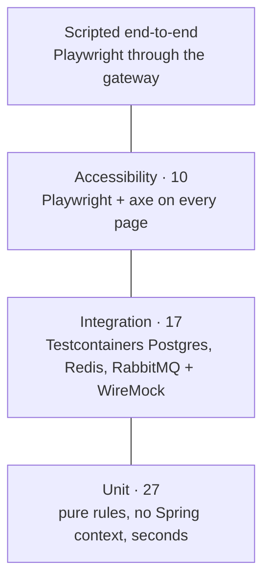
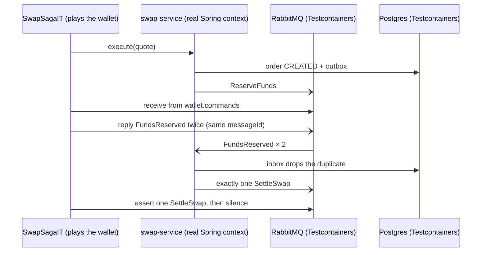

# 8. Testing strategy

## The problem

Mocks lie about exactly the things that break distributed financial systems: SQL constraints,
row locks, transaction isolation, message redelivery, serialization, timing. A test suite of
mocked repositories can be green while the ledger double-spends under concurrency.

## The pyramid we use

| Layer | Runs | What it proves | Count |
|---|---|---|---|
| Unit | `mvn test` (no Docker, seconds) | pure rules: price model determinism, ledger validation & hashing, state machine, rate-limit keys and policies, sanitizers | 27 |
| Integration (Testcontainers) | `mvn verify` (Docker) | real Postgres/Redis/RabbitMQ behaviour + WireMock for CoinGecko | 17 |
| AI component | `mvn test` | copilot parsing, knowledge retrieval on the real corpus | 10 (5 + 5) |
| Accessibility | `npm run a11y` (Playwright + axe) | no serious/critical violations on every page; detection rate on a seeded lab page | 10 |
| End-to-end (manual/scripted) | Playwright scripts, curl | full user flows through the gateway | — |

Surefire runs `*Test`, Failsafe runs `*IT` (configured in the root `pom.xml`, with
`classesDirectory` set so Failsafe tests compiled classes rather than the repackaged Spring Boot jar).



Fewer, slower, more realistic tests at the top; many fast ones at the bottom.


## Integration tests worth reading

- [`LedgerIT`](../../services/wallet-service/src/test/java/dev/opencrypto/walletservice/LedgerIT.java):
  **20 threads** reserve 1,000 USD each against a 10,000 USD balance, all released by a
  `CountDownLatch` at the same instant → exactly 10 HELD, 10 REJECTED, reconciliation OK.
  **8 concurrent retries** with one idempotency key → 1 credit, 7 replays. Raw SQL attempts to
  edit history, create money or overdraw are rejected by the database.
- [`SwapSagaIT`](../../services/swap-service/src/test/java/dev/opencrypto/swapservice/SwapSagaIT.java):
  the test *plays the wallet* on a real RabbitMQ, reading commands from `wallet.commands` and
  replying with events, to script: happy path, rejection, price moved, **timeout → late success**,
  and **the same message delivered twice** (processed once).
- [`MarketDataIT`](../../services/asset-service/src/test/java/dev/opencrypto/assetservice/MarketDataIT.java):
  WireMock plays CoinGecko. Sync + backfill + cache, Redis-miss fallback, **429s → retries →
  circuit opens → no more upstream calls**, and SQL-injection-proof sorting.
- [`RateLimitIT`](../../services/api-gateway/src/test/java/dev/opencrypto/apigateway/RateLimitIT.java):
  real Redis, burst honoured, per-user isolation, RFC 7807 429 with `Retry-After`.

**How `SwapSagaIT` tests the saga without a wallet**: the test *is* the wallet.




## Techniques

- **Testcontainers with `@DynamicPropertySource`.** Containers start once per class; the JDBC URL
  gets `&currentSchema=...` so tests use the same schema layout as production.
- **Deterministic time and randomness.** Seeds for the price model; refill rates chosen so rate
  limiting doesn't depend on machine speed (a timing-dependent version failed on Windows).
- **Test through the real seams.** `@MockitoBean` replaces only the outbound HTTP client
  (`MarketClient`, `AssetClient`); everything inside the service runs for real.
- **Awaitility for async flows** instead of `Thread.sleep`.

## See it yourself

```bash
mvn test                      # unit tests only, ~1 minute, no Docker
mvn verify                    # everything, ~6 minutes, Docker required
cd frontend && PW_CHANNEL=msedge npm run a11y   # or: npx playwright install chromium && npm run a11y
```

## Where the reports are (every run)

| Output | Location | How to open |
|---|---|---|
| Playwright **HTML report** (latest run, overwritten each time) | `frontend/playwright-report/index.html` | `npm run a11y:report` (serves it at http://localhost:9323), or open the file |
| Per page in that report | annotation "axe: N findings · M rules passed", attachments `axe-findings.json` + `page.png`; on failure also a screenshot and a **trace** (DOM, network, console replay) | click a test |
| Raw axe findings (JSON, for tools/AI review) | `frontend/a11y-report/app-*.json`, `seeded-lab.json` | any editor |
| Java tests | `services/*/target/surefire-reports/` (unit), `failsafe-reports/` (integration) | XML/TXT per test class |
| CI | GitHub Actions run → **Artifacts** → `a11y-report` (contains both folders) | download the zip |

`public/a11y-lab.html` is **not** a report: it's a deliberately broken practice page with known issues
(answer key `a11y/seeded-issues.json`). The "seeded lab" test measures how many of them axe catches; the
rest need a human (or, later, your AI reviewer). Open it at http://localhost:5173/a11y-lab.html.

## Pitfalls we hit

- ShedLock's `lockAtLeastFor` silently skipped repeated calls in tests.
- Asserting on Spring's wrapped exception message instead of the database error in the cause
  (`hasStackTraceContaining` fixed it).
- A background poller logging errors while the test context shut down its containers.

## Interview questions

- Why aren't mocked repositories enough for a ledger?
- How do you write a reliable concurrency test?
- How do you test a saga's timeout path without waiting 30 seconds?
- What's the difference between Surefire and Failsafe, and why separate them?
