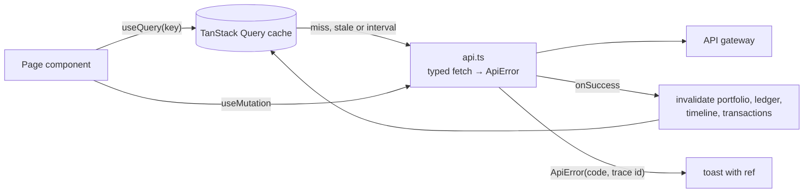
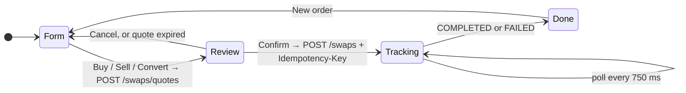

# 9. Frontend architecture

## The problem

Product UIs over microservices fail in predictable ways: stale numbers after an action, spinners
that never end, double-submitted payments, error messages nobody can act on, layouts that break on
phones, and "modern" component libraries that quietly ship inaccessible markup.

## The stack (and why)

| Layer | Choice | Why |
|---|---|---|
| Framework | React 19 + TypeScript + Vite 6 | Fast dev server, typed API client |
| Styling | **Tailwind CSS v4** with design tokens as CSS variables | Utility classes, one theme file, no CSS-in-JS runtime |
| Components | **shadcn/ui** (Radix primitives) | Accessible primitives (focus, keyboard, ARIA) *copied into the repo* (`src/components/ui`), so you own and can fix them |
| Icons | lucide-react | Consistent, tree-shaken |
| Charts | **TradingView Lightweight Charts** v5 | The standard for crypto price charts: canvas rendering, crosshair, candles |
| Server state | TanStack Query | Caching, background refetch, dedupe |
| Routing | React Router 7 | Real, shareable URLs |
| Toasts / ⌘K | sonner, cmdk | The usual pair in shadcn apps |

## Layout: a "pro exchange" shell

```text
┌ sidebar (collapsible to icons, a sheet on mobile) ┬ top bar: ⌘K search · Live · theme · Copilot · account ┐
│ Trading: Markets, Trade, Portfolio, Activity,     ├ live ticker strip (pauses on hover/focus)            ┤
│          Wallet                                    │ page                                    │ copilot  │
│ Platform: Status, Market Lab, Knowledge           │                                         │ (docked  │
└───────────────────────────────────────────────────┴─────────────────────────────────────────┴ ≥1280px) ┘
```

- **Dark-first** like a trading terminal, with light and system themes
  ([`theme.tsx`](../../frontend/src/lib/theme.tsx)). An inline script in `index.html` applies the
  saved theme before React loads, so the page never flashes white.
- **Design tokens** live in [`index.css`](../../frontend/src/index.css): surfaces, `--up`/`--down`
  for market direction, `--warning`, and the validated categorical palette for asset identity
  colours. Every text/background pair was chosen for ≥ 4.5:1 contrast in *both* themes.
- **Trade page**: pair bar, chart and order panel side by side; Buy / Sell / Convert; quick 25/50/75/Max
  amounts; a live estimate before you even ask for a quote; then review → confirm → a live order
  stepper that follows the saga.

## Diagrams

**Data flow.** Components never call `fetch` directly; everything goes through the query cache.



**The order panel's states** (Trade page).




## What we did (the engineering, not the paint)

**Server state lives in TanStack Query.** Every read is a query with a key; lists keep previous data
while paging; 4xx and 429 are never retried. Shared queries (the catalogue that feeds the ticker,
⌘K, pickers and icons) live in [`queries.ts`](../../frontend/src/lib/queries.ts), so one request
feeds five widgets.

**Mutations invalidate what they change.** After a deposit, reset or a finished swap, `portfolio`,
`timeline`, `ledger`, `transactions` … are invalidated, so every screen shows the new balance.

**Money-safe actions.** One Idempotency-Key per quote (double clicks and retries can't trade twice);
amounts sent as strings; the quote shows minimum received, fee and a live expiry bar; destructive
actions (wallet reset) go through a confirmation dialog.

**Errors people can act on.** Every failure becomes an `ApiError` with the RFC 7807 `code` and the
request's **trace id**; toasts show "INSUFFICIENT_FUNDS · ref f9bd1547…", and the Status page opens
that trace in Grafana. An **error boundary** per route means one broken component shows a recovery
card instead of a blank app.

**Performance.** Pages are lazy-loaded (`React.lazy`) and vendor code is split into long-lived
chunks (react, ui, charts). The chart library (180 kB) only downloads on pages with charts.

**Accessibility is tested, not hoped for.** Playwright + axe scan all 9 pages in CI; the redesign
ships with **zero findings of any severity**.

## Pitfalls we hit in the redesign (all caught by tests or screenshots)

| Symptom | Root cause | Fix |
|---|---|---|
| axe *critical*: `aria-valid-attr-value` | Used **Tabs** for filters; tabs promise panels via `aria-controls` that didn't exist | Filters are a single-select **toggle group** ([`Segmented`](../../frontend/src/components/segmented.tsx)): right semantics for "filter", not "tab" |
| axe: `nested-interactive` on the chart | `role="img"` on a container that holds TradingView's attribution link | `<figure>` + screen-reader `<figcaption>` summary (first/last/low/high) |
| axe: `label-content-name-mismatch` | `aria-label` on the account button didn't contain its visible text | Name comes from visible text + `sr-only` suffix |
| axe: `color-contrast` | White on the brand blue was 4.4:1 | Brand blue darkened to 5.5:1 |
| ⌘K **blanked the whole app** | The current shadcn `CommandDialog` expects a `<Command>` root inside; without it cmdk crashes | Wrap in `<Command>`; add error boundaries so a crash is contained |
| Tablet layout 1070 px wide | shadcn's `Button` has `shrink-0`, so the search button wouldn't shrink | `shrink` override; automated overflow check at 4 widths × 9 pages |
| React warning "script tag" | `next-themes` injects an SSR script, pointless in a Vite SPA | 40-line own theme provider |
| Dropdowns closing every 10 s | A component defined *inside* another component is a new type each render, so React remounts it | Hoist components to module level |

## See it yourself

```bash
cd frontend && npm run dev                       # http://localhost:5173 — try Ctrl+K, the theme menu, Ctrl+B (sidebar)
npm run build                                    # type-check + production bundle (see the chunk list)
PW_CHANNEL=msedge npm run a11y                   # axe on every page
npx shadcn@latest add <component>                # add more primitives; they land in src/components/ui
```

## Interview questions

- Server state vs client state: why not keep API data in Redux/useState?
- Why does shadcn/ui copy components into your repo instead of shipping a package? What's the trade-off?
- When is something a tab and when is it a filter? Why does ARIA care?
- How do you make a canvas chart accessible?
- How do you stop a user from submitting a payment twice?
- How would you find what makes a page overflow on mobile?
