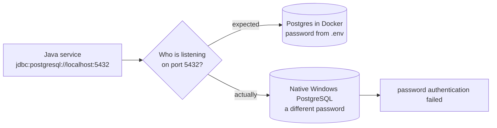

# 10. Real bugs we hit (and what they teach)

These all happened while building this project. Each is a ready-made answer to "tell me about a
tricky bug you fixed": **symptom → investigation → root cause → fix → lesson**.

### 1. The Docker images could never have started
- **Symptom:** `no main manifest attribute, in app.jar`.
- **Root cause:** the root POM imports Spring Boot's BOM instead of using `spring-boot-starter-parent`,
  so the `repackage` goal was never bound: Maven built a plain library jar.
- **Fix:** bind `spring-boot-maven-plugin:repackage` in `pluginManagement`.
- **Lesson:** a BOM gives you versions, not the parent's plugin configuration. Know what the parent POM did for you.

### 2. Endpoints with query parameters returned 500
- **Symptom:** `Name for argument of type [int] not specified ... use the '-parameters' flag`.
- **Root cause:** same as #1: the starter parent also enables `javac -parameters`.
- **Fix:** `<parameters>true</parameters>` on the compiler plugin.

### 3. The gateway refused to start
- **Symptom:** `Unable to parse PredicateDefinition text '/api/v1/market/**'`.
- **Root cause:** YAML flow list `[Path=/a/**,/b/**]` splits on the comma into two predicates.
- **Fix:** quote it (`["Path=/a/**,/b/**"]`), and later moved routes to type-checked Java config.
- **Lesson:** YAML is a programming language with surprising syntax; prefer code for logic-like config.

### 4. `docker-compose.yml` was invalid from day one
- **Root cause:** `${VAR:-default}` inside a YAML flow mapping `{...}` must be quoted.
- **Lesson:** run `docker compose config -q` in CI.

### 5. "Password authentication failed" with the right password
- **Investigation:** the password worked inside the container. `netstat` showed **two processes on
  port 5432**: Docker and a native PostgreSQL Windows service. Same story for Redis (6379) and a WSL
  relay on RabbitMQ's port; Java preferred IPv6 `::1` and reached the wrong broker.
- **Fix:** Docker infra on 5433/6380/5673; services default to those ports.
- **Lesson:** when credentials "obviously" match, check *which server* you're talking to.

### 6. The disk filled up mid-build
- **Symptom:** `No space left on device`; one config file was truncated to 0 bytes.
- **Fix:** stopped writers (services, Postgres, Prometheus), restored the file, verified the others,
  freed caches (npm, Docker build cache).
- **Lesson:** after a disk-full event, verify every file written around that time; partial writes are silent.

### 7. Rebuilding failed while services ran (Windows)
- **Root cause:** Windows locks a running jar, so Maven couldn't overwrite `target/*.jar`.
- **Fix:** the run scripts launch a **copy** in `.run/jars/`.

### 8. Scheduled job silently didn't run in tests
- **Root cause:** `@SchedulerLock(lockAtLeastFor = "PT15S")`: a second call within 15 s is skipped
  *without an error*, by design.
- **Fix:** tests call the unlocked `syncOnce()`; the scheduled entry point keeps the lock.

### 9. `UnexpectedRollbackException` after catching an exception
- **Root cause:** an exception passing through a `@Transactional` proxy marks the *outer* transaction
  rollback-only even if the caller catches it.
- **Fix:** check funds under a row lock before posting, and treat "insufficient" as data, not an exception.
- **Lesson:** don't use exceptions for expected business outcomes inside transactions.

### 10. A timeout must not decide the outcome
- **Design bug caught before shipping:** marking a swap FAILED after 30 s would be wrong if the
  wallet settled at second 31.
- **Fix:** the timeout asks the wallet to release; the wallet answers with the truth (released or
  settled). `SwapSagaIT.timeoutAsksWalletAndAcceptsLateSuccess` proves it; so does a manual
  kill-the-wallet test.

### 11. A new read model was empty
- **Symptom:** the activity feed missed earlier swaps.
- **Root cause:** its queue didn't exist when those events were published, so RabbitMQ had nowhere
  to route them.
- **Lesson:** new projections need a backfill/replay strategy (event store, or re-publish from outbox).

### 12. Rate limiting broke a read-only feature
- **Symptom:** the knowledge-search evaluation got 429s.
- **Root cause:** policies were chosen by HTTP verb; search is a POST that only reads.
- **Fix:** cost-based policies (read / write / ai) and clients that honour `Retry-After`.

### 13. A test passed on Linux and failed on Windows
- **Root cause:** connecting to a closed port takes ~2 s on Windows (SYN retries), so the token
  bucket refilled between requests.
- **Fix:** make the test independent of timing (refill one request per minute).
- **Lesson:** timing assumptions are hidden platform dependencies.

### 14. Mobile page 623 px wide
- **Investigation:** a script listed elements whose right edge exceeded the viewport and weren't
  inside a scroll container: the top bar and `<main>`.
- **Root cause:** CSS grid `1fr` = `minmax(auto, 1fr)`; `auto` is the content's minimum width.
- **Fix:** `minmax(0, 1fr)` on the app and page grids.

### 15. Mapping `timestamptz` to `Instant`
- **Root cause:** the Postgres JDBC driver doesn't support `getObject(col, Instant.class)`, so
  automatic record mapping failed at runtime.
- **Fix:** explicit row mappers via `getTimestamp(...).toInstant()`.

### 16. Failed swaps were invisible on the dashboard
- **Symptom:** while tracing a failed swap by its correlation id, swap-service logged
  `The meter swap.orders registration has failed: Prometheus requires that all meters with the same
  name have the same set of tag keys`.
- **Root cause:** accepted/completed swaps were counted with the label `{result}`, failed ones with
  `{result, reason}`. The first registration wins; the failed counter was dropped, so the "failed
  swaps by reason" panel and anything built on it always showed zero.
- **Fix:** the same label keys everywhere (`reason="none"` when there is no reason).
- **Lesson:** observability code has bugs too, and a dashboard that shows zero can be lying. Test
  your alerts by causing the failure on purpose.

### 17. A YAML edit silently disabled the gateway's Redis and timeout settings
- **Symptom:** none at first. Found while adding tracing config: the gateway's `spring.data.redis`
  and `spring.cloud.gateway.httpclient` blocks had ended up *under* `logging:`.
- **Root cause:** a `logging:` block was inserted in the middle of the `spring:` mapping. YAML
  nesting is by indentation, so everything after it became `logging.data.redis...`, which Spring
  ignores without an error. The gateway fell back to defaults: Redis on 6379 (the *native* Redis
  on this machine, not the Docker one) and no upstream timeouts.
- **Fix:** moved the block; checked by parsing the file and printing the effective keys.
- **Lesson:** unknown configuration keys fail silently in Spring. After editing YAML, verify the
  *effective* config (parse it, or `/actuator/configprops` and `/actuator/env`), not just that the app starts.

### 18. A flaky test that had been passing by luck
- **Symptom:** `SwapSagaIT.duplicateDeliveryIsProcessedOnce` failed after an unrelated change.
- **Root cause:** the test waited 2 s to prove "no second SettleSwap", but the swap timeout in the
  test was also 2 s, so the recovery job's (correct) `ReleaseFunds` sometimes arrived inside the
  window and was counted as a duplicate. Slightly slower startup changed who won the race.
- **Fix:** complete the saga first, then assert silence. The test now checks what its name says.
- **Lesson:** two timers with the same duration in one test are a race. When a test fails after an
  unrelated change, suspect timing before suspecting the change.

### 19. Shared database migrations can't use version numbers
- **Problem:** `platform-common` ships SQL migrations into every service (`db/platform`). Adding a
  column for tracing as `V0_2__...` would sort *before* migrations the services had already applied
  (`V1`, `V2`), and Flyway refuses to start on out-of-order versions.
- **Fix:** an idempotent **repeatable** migration (`R__platform_outbox_tracing.sql` with
  `ADD COLUMN IF NOT EXISTS`).
- **Lesson:** when one library contributes schema to many services, version numbering is the hard
  part. Options: repeatable idempotent scripts, a separate Flyway history table per library, or
  moving the shared tables into their own schema.

### 20. A "quick check" polluted production-like data
- **Symptom:** the new price charts showed BTC jumping to $89k and ETH dipping to $1.6k for an hour.
- **Investigation:** `price_snapshot.source` showed 21,732 `SIMULATED` rows in a one-hour window on a
  stack that runs on CoinGecko.
- **Root cause:** to check the JSON log format, asset-service was started for 40 s in *simulated* mode
  against the shared local database. The simulator backfills an hour of history on start-up.
- **Fix:** deleted the rows by `source` and time window in one transaction; cleared the Redis price cache.
- **Lesson:** experiments get their own database (Testcontainers, a throwaway schema, or a
  `--spring.profiles.active=scratch`). Store provenance (`source`) on every row: it's what made the
  clean-up precise instead of a guess.

### 21. A modern UI library is not automatically accessible
- **Symptom:** the shadcn/ui redesign looked finished but failed axe on all 9 pages (1 critical, 4 serious rules).
- **Root cause:** components used for the wrong semantics (tabs as filters), ARIA on canvas wrappers,
  label/name mismatches, and a brand colour 0.1 below the contrast threshold.
- **Lesson:** keep the accessibility scan in CI from day one. It caught every one of these before a
  user did. Details in [chapter 9](09-frontend.md).

### 22. Every service crashed on start: a variable meant for Docker
- **Symptom:** after `.\scripts\run-local.ps1`, all seven services died during startup, including the ones
  without a database. `run-local.sh` on the same code worked.
- **Investigation:** every log ended with the same cause:
  `NoSuchFileException: prometheus-host.yml at io.prometheus.metrics.config.PrometheusPropertiesLoader`.
- **Root cause:** the script set `$env:PROMETHEUS_CONFIG = 'prometheus-host.yml'` to tell Docker Compose which
  Prometheus *server* config to mount. In PowerShell, `$env:` is process-wide, so every `java` started later
  inherited it, and the **Prometheus Java client** inside each service reads `PROMETHEUS_CONFIG` as the path
  of *its own* properties file. The bash script set it only for the `docker compose` command
  (`VAR=x cmd`), so it never reached Java.
- **Fix:** renamed the Compose variable to `PROMETHEUS_SERVER_CONFIG` (compose file + both scripts), and
  the PowerShell script removes any leftover `PROMETHEUS_CONFIG` from the session before starting Java.
- **Lesson:** environment variables are a global namespace shared with every library in every child
  process. Give your own variables a specific name, and scope them to the one command that needs them.

### 23. A shared-library change silently never reached three services
- **Symptom:** after adding span naming to `platform-common` and rebuilding, the gateway's spans had new
  names but swap, wallet and asset service calls were still plain `http get`.
- **Investigation:** `swap-service`'s jar was from 14:41, half an hour older than the `platform-common`
  it should contain. Unzipping it showed the old library inside. A second plain `mvn package` left it untouched.
- **Root cause:** `maven-jar-plugin` doesn't recreate a jar when the module's **own** classes are unchanged.
  Spring Boot's `repackage` then finds a jar that's already repackaged and skips it too. So a module
  that only had a *dependency* change kept its old fat jar, old library included. The gateway was rebuilt only
  because its own code had changed.
- **Fix:** `forceCreation=true` for `maven-jar-plugin` in the root `pom.xml`, so every build repackages with
  the current dependencies. Verified by checking that each service jar contains the new class.
- **Lesson:** "it built" is not "it shipped". When a change doesn't show up, check the artifact you're
  running (timestamp, contents) before doubting the code. In CI, build from clean.

### 24. One scheduler thread stopped every event from leaving
- **Symptom:** under load, swap-service published **no outbox events for 2 min 20 s** while it kept writing
  hundreds. The backlog gauge froze at 820.
- **Investigation:** the published timestamps in `outbox_event` showed zero publishes in that window. Logs showed
  the outbox and `SwapRecoveryJob` on the same thread, `scheduling-1`.
- **Root cause:** Spring Boot's default `@Scheduled` pool has **one thread**. The recovery job, waiting
  for database connections behind 154 status polls/s, held it for minutes, so the outbox poller never ran.
- **Fix:** `OutboxPublisher` runs on its own thread (`SmartLifecycle` + a single-thread executor). Not with a
  `TaskScheduler` bean: defining one switches off Boot's default scheduler and moves every job onto it.
- **Lesson:** isolate critical background work (a *bulkhead*). Shared pools are the hidden coupling in a
  service. Details and measurements in [chapter 11](11-load-testing.md).
