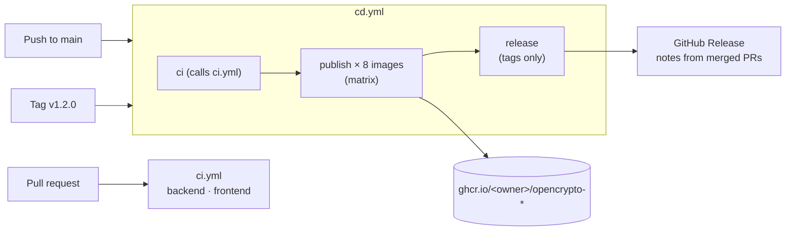

# 12. Publishing on GitHub with CI/CD

## The problem

The project lived in a Downloads folder. That has three costs:

- **Nobody can see it.** A resume link to a repo with green checks, readable docs and published
  images is worth more than any bullet point.
- **Nothing proves it works.** "49 tests pass" only means something if a machine that isn't yours
  runs them on every change, from a clean checkout.
- **Releasing is manual.** Running the stack means building 8 images locally. Every manual step is
  a step someone can get wrong or skip.

Publishing also has risks: a leaked secret, a public repo nobody may legally reuse, Windows line
endings that break shell scripts on Linux, and a `main` branch anyone (including you, tired) can
push broken code to.

## Words first

| Term | Meaning |
|---|---|
| **CI** (continuous integration) | Every change is built and tested automatically before it's merged. |
| **Continuous delivery** | Every green change on `main` produces a **release-ready artifact** (here: Docker images). Deploying it is one command or click. |
| **Continuous deployment** | Every green change is also **deployed** automatically. The step after delivery. |
| **Workflow / job / step** | A workflow is a YAML file in `.github/workflows/`. It has jobs (each on a fresh VM, in parallel unless `needs:` says otherwise); a job has steps (shell commands or reusable *actions*). |
| **Runner** | The VM that runs a job. `ubuntu-latest` has Docker, Java, Node and more preinstalled. |
| **Artifact registry** | Where built images live. We use **GHCR** (`ghcr.io`), free for public repos, authenticated with the built-in `GITHUB_TOKEN`. |

## Options

**Where CI runs:** GitHub Actions, GitLab CI, Jenkins, CircleCI. Actions is the default for a
GitHub repo: no server to run, free minutes for public repos, and the results appear on every PR.

**What "CD" publishes and where it deploys:**

| Option | Cost | Fits this project? |
|---|---|---|
| Docker images to GHCR (continuous **delivery**) | free | **Yes.** Anyone runs the exact tested build with one `docker compose` command. |
| Deploy to a VM (SSH + `docker compose pull && up`) | ~5 €/month | Good next step; needs secrets and a server. |
| Kubernetes (k3s, AKS, GKE) | more | Overkill for a demo; great later as a learning chapter. |
| Frontend to GitHub Pages | free | The UI needs the gateway, so a static site alone would mostly show errors. |

**How CD waits for CI:**

| Approach | Trade-off |
|---|---|
| Copy the test jobs into the CD file | duplicated YAML that drifts apart |
| `workflow_run` (CD triggers when CI finishes) | checks out the *default branch* unless you pass `head_sha`; easy to publish the wrong commit |
| **Reusable workflow** (`workflow_call`) | CI is defined once; CD calls it as a job and `needs:` it. **Chosen.** |

## What we did



### 1. CI: [`.github/workflows/ci.yml`](../../.github/workflows/ci.yml)

- Triggers: `pull_request` to `main`, `workflow_call` (so CD can reuse it) and `workflow_dispatch`
  (a "Run workflow" button).
- **backend**: `mvn verify` runs the unit tests and the Testcontainers tests against real
  Postgres/Redis/RabbitMQ. That works because GitHub's Ubuntu runners have Docker. Both compose
  files are validated too. If a test fails, the Surefire/Failsafe reports are uploaded so you can
  read them from the run page.
- **frontend**: `npm ci` (exact versions from the lockfile), type-check + build, and the axe
  accessibility lab in Playwright.
- `permissions: contents: read`: the token can read the code and nothing else. Least privilege.
- `concurrency` with `cancel-in-progress` on PRs: pushing a fix cancels the run that's now out of date.
- `timeout-minutes`: a hung Testcontainers start fails after 30 minutes, not GitHub's default 6 hours.

### 2. CD: [`.github/workflows/cd.yml`](../../.github/workflows/cd.yml)

- Triggers: push to `main`, push of a tag matching `v*.*.*`.
- `ci` job: `uses: ./.github/workflows/ci.yml`. The same tests gate every publish.
- `publish` job: a **matrix** of 8 entries (7 Java services share
  [`services/Dockerfile`](../../services/Dockerfile) with a `SERVICE` build arg, plus the frontend).
  The 8 builds run in parallel and `fail-fast: false` stops one failure from cancelling the rest.
  - `docker/login-action` signs in to GHCR with `GITHUB_TOKEN`. No personal token is stored anywhere.
  - Only this job gets `packages: write`.
  - `docker/metadata-action` turns the git ref into tags:

    | Event | Tags |
    |---|---|
    | push to `main` | `latest`, `sha-1a2b3c4` |
    | tag `v1.2.0` | `1.2.0`, `1.2`, `sha-1a2b3c4` |

    It also adds OCI labels (`org.opencontainers.image.source`) that link the package to the repo.
  - `cache-from/to: type=gha`: Docker layers are cached between runs, so an unchanged Maven
    dependency layer isn't rebuilt.
- `release` job (tags only): `gh release create --generate-notes` writes release notes from the
  PR titles merged since the previous tag. That's one reason PR titles matter.

### 3. Running the published build: [`docker-compose.release.yml`](../../docker-compose.release.yml)

An override file: same services, but `image: ghcr.io/...` with `pull_policy: always`, so compose
pulls instead of building. `OPENCRYPTO_TAG=1.2.0` pins a release; `sha-1a2b3c4` pins one commit.

### 4. Repo hygiene

| File | Why |
|---|---|
| [`LICENSE`](../../LICENSE) (MIT) | Without a license, public code is "all rights reserved": readable but not reusable. |
| [`.gitattributes`](../../.gitattributes) | Stores text with LF. A `run-local.sh` committed with CRLF fails on Linux with `/usr/bin/env: 'bash\r': No such file or directory`. |
| [`.gitignore`](../../.gitignore) | Keeps `.env`, `target/`, `node_modules/`, `.run/` (jars and logs) and test reports out. |
| [`pull_request_template.md`](../../.github/pull_request_template.md), [`ISSUE_TEMPLATE/`](../../.github/ISSUE_TEMPLATE/) | Every PR says what, why and how it was verified. |
| [`CONTRIBUTING.md`](../../CONTRIBUTING.md) | Branch → PR → green CI → squash-merge → tag. |

## See it yourself: publishing step by step

### Step 0: check before the first commit (it's permanent)

```bash
git status --short | head -50          # is anything here that shouldn't be public?
git add -A --dry-run | grep -Ei '\.env$|\.jar$|\.log$|secret|key'   # should print nothing
git grep -nE 'ghp_[A-Za-z0-9]{20,}|sk-[A-Za-z0-9]{20,}|AKIA[0-9A-Z]{16}|BEGIN .*PRIVATE KEY'
```

A secret that reaches GitHub even once must be **revoked/rotated**, not just deleted. Deleting the
file leaves it in history, and bots scan new public repos within minutes.

Also check which email your commits will show:

```bash
git config user.email      # a work email here makes it public in every commit
# Use GitHub's private noreply address for this repo only (Settings → Emails shows yours):
git config user.email "<id>+<username>@users.noreply.github.com"
```

### Step 1: first commit

```bash
git init -b main
git update-index --chmod=+x scripts/*.sh   # Windows doesn't record the executable bit
git add -A
git commit -m "Initial commit: OpenCrypto Copilot"
```

### Step 2: create the repo and push

```bash
gh repo create opencrypto-copilot --public --source . --remote origin --push \
  --description "Crypto trading platform: Spring Boot microservices, double-entry ledger, RabbitMQ saga, observability, React"
```

Without `gh`: create an **empty** repo on github.com (no README or license, or the first push is
rejected), then `git remote add origin https://github.com/<you>/opencrypto-copilot.git && git push -u origin main`.

### Step 3: watch the first run

```bash
gh run watch                 # live progress of the latest run
gh run list --limit 5
gh run view --log-failed     # only the logs of failed steps
```

Or the **Actions** tab. The push to `main` runs **CI/CD**: `ci / Backend`, `ci / Frontend`, then the
8 `Publish` jobs.

### Step 4: make the images public

The first time a package is published to GHCR it may be **private**, even from a public repo. Open
your profile → **Packages** → `opencrypto-api-gateway` → **Package settings** → *Change visibility* →
Public. Do it for each of the 8 packages (once). Then test it with no login:

```bash
docker logout ghcr.io
docker pull ghcr.io/<you>/opencrypto-api-gateway:latest
```

### Step 5: protect `main`

**Settings → Rules → Rulesets → New branch ruleset**, target the default branch:

- ✅ Restrict deletions, ✅ Block force pushes
- ✅ Require a pull request before merging (0 approvals is fine when you're the only developer)
- ✅ Require status checks to pass: add `Backend (unit + Testcontainers)` and
  `Frontend (build + a11y)`. The checks only show up in the list after CI has run once on a PR.

From now on: `git switch -c feat/x` → push → `gh pr create --fill` → wait for green → `gh pr merge --squash --delete-branch`.

### Step 6: make the repo page sell itself

Repo **About** (⚙ next to it): description, topics (`spring-boot`, `microservices`, `saga-pattern`,
`rabbitmq`, `opentelemetry`, `react`, `testcontainers`, `double-entry-accounting`), and tick
*Packages* and *Releases*. Pin the repo on your profile. Add a screenshot or GIF of the Trade page to
the README; it's the first thing people look at.

Also turn on **Settings → Code security**: secret scanning with push protection
(blocks a push that contains a known token format), and CodeQL "default setup" for Java and
TypeScript. They're all free on public repos and need no YAML.

### Step 7: cut a release

```bash
git switch main && git pull
git tag -a v0.1.0 -m "First public release"
git push origin v0.1.0
```

This publishes `:0.1.0` and `:0.1` images plus a GitHub Release. Versions follow
[SemVer](https://semver.org/): MAJOR for breaking API changes, MINOR for features, PATCH for fixes.

## Pitfalls

- **Calling a reusable workflow that has the same `concurrency` group as the caller.** The called
  workflow waits for the group the caller holds, so the run is cancelled or blocked. That's why
  `ci.yml` puts `github.event_name` in its group and `cd.yml` uses a `cd-` prefix.
- **Required check names.** In CD the backend check appears as `ci / Backend (...)` (caller job
  name / called job name); on a PR it's `Backend (...)`. Rulesets apply to PRs, so require the PR names.
- **Deploying `latest`.** It moves on every merge, so two servers that pulled at different times run
  different code. Deploy a version or `sha-` tag; `latest` is for trying it out.
- **Registry paths must be lowercase.** `ghcr.io/Poran/...` is rejected; the workflow lowercases the owner.
- **PRs from forks** get a read-only token and no secrets. Our CI needs neither, so it works for
  contributors. Never use `pull_request_target` to "fix" that without understanding it: it runs
  with write access while the PR's code is untrusted.
- **Third-party actions are code you run with your token.** We use only official `actions/*` and
  `docker/*`. Stricter setups pin them by commit SHA (`uses: docker/login-action@<sha>`) and
  update the SHAs with a bot.
- **Automated dependency PRs without limits are noise.** We tried Dependabot, and its first scan
  opened 12 PRs at once, mostly major upgrades (Spring Boot 3 → 4, TypeScript 5 → 7, Vite 6 → 8,
  Node 20 → 26). Each major version needs real migration work, so we removed it and upgrade by hand
  instead. If you add a bot again, start with `ignore: [{dependency-name: "*", update-types:
  ["version-update:semver-major"]}]` and `open-pull-requests-limit`.
- **Testcontainers needs Docker.** It works on `ubuntu-latest`, but not on GitHub's Windows or macOS
  runners.
- **`npm install` in CI** can resolve different versions than your laptop did. Use `npm ci`: it
  installs exactly what the lockfile says and fails if `package.json` and the lockfile disagree.

## Next steps (good future chapters)

1. **Continuous deployment to a VM**: a `deploy` job with a GitHub **Environment** called
   `production` (required reviewer = you, so it waits for a click), an SSH key in environment secrets,
   and `docker compose pull && up -d` with `OPENCRYPTO_TAG=sha-...`. Then a smoke test: `curl` the
   gateway's health endpoint, and roll back to the previous tag if it fails.
2. **Supply-chain security**: Trivy image scan in CI, SBOM and provenance attestations
   (`docker/build-push-action` with `provenance: true`, `sbom: true`), signing with cosign.
3. **Build only what changed**: path filters so a frontend-only PR skips the Maven job.
4. **Kubernetes**: Helm chart + k3d in CI, then Argo CD (GitOps) pulling the tags CD publishes.

## Interview questions

1. What's the difference between continuous delivery and continuous deployment? Which does this repo do?
2. How do you make sure the image you deploy is the one that passed the tests? (Same workflow
   run, `needs: ci`, immutable `sha-` tags.)
3. Why `GITHUB_TOKEN` instead of a personal access token? What does `permissions:` change?
4. You committed an API key and pushed it. What do you do? (Revoke/rotate it first, then rewrite
   history if needed. Assume it's already leaked.)
5. Why are `latest` tags dangerous in production?
6. How would you stop a broken commit from ever reaching `main`?
7. CI is slow (12 minutes). Where do you look? (Caching, parallel jobs, path filters, splitting
   unit and integration tests, test reports for the slowest tests.)
