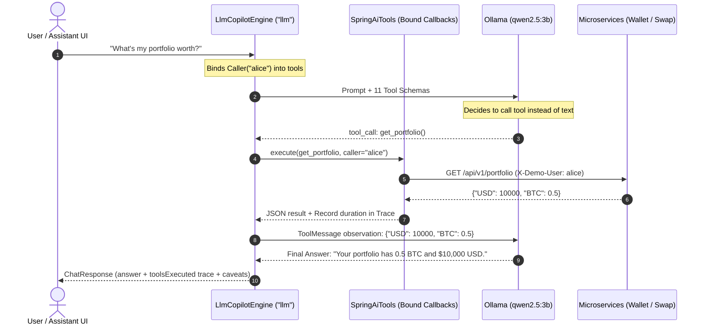

# 15. Step 2: The Tool-Calling Agent

Step 2 of the [agentic system roadmap](../ai/agentic-system.md). Moving from the Step 1 refusal baseline
to an autonomous agent that inspects tool schemas, invokes read-only platform APIs, and returns grounded answers.

---

## 1. The Problem

In **Step 1** ([14-plain-llm-baseline.md](14-plain-llm-baseline.md)), we connected a plain local model (`qwen2.5:3b`)
with **zero tools**. When asked:

> *"What is my portfolio worth right now?"*

It had no live data, so it safely refused: *"I don't have access to your portfolio."* While honest, this
assistant is incapable of performing real support tasks (answering 0/50 evaluation questions from live tools).

However, simply attaching tools creates two new engineering problems:
1. **Tool Overload & Context Bloat:** Dumping all 11 tool schemas into a 3B parameter model's context
   consumes thousands of prompt tokens. On a CPU, this degrades response latency and can confuse a smaller model
   into picking invalid tools or generating malformed arguments.
2. **Multi-Turn Function Calling Loops:** A model does not answer directly when it needs data; it returns a
   structured `tool_call` request. The backend must intercept this call, execute the function safely in the
   target microservice, append the tool output as a observation message, and loop back to the model for the
   final grounded answer.

---

## 2. Options & Trade-offs

| Decision | Options | Trade-off |
|---|---|---|
| **Loop Mechanics** | Manual `while` loop · Spring AI managed loop (`.toolCallbacks(...)`) | Full visibility into every JSON round trip, but requires manual message state management · Framework handles recursion, but can hide infinite loop bugs if unbounded |
| **Model Selection** | Local Ollama (`qwen2.5:3b`) · Hosted Claude (`claude-opus-5-5`) | 100% private, free, runs offline, but slower on CPU and sensitive to prompt formatting · Exceptional reasoning and tool selection, but costs money and requires network egress |
| **State Changes** | Direct trade execution by agent · Proposed Action (`ProposedAction`) | Catastrophic security risk (model prompt injection could drain funds) · **Propose-only**: Agent generates a quote; human explicitly confirms in the UI; backend re-validates |
| **Identity Context** | Caller passed as tool argument · Caller bound in closure | Model could spoof identity by passing `userId="bob"` · Caller extracted strictly from verified gateway header (`X-Demo-User`) |

---

## 3. What We Did

### The Architecture: ReAct Function Calling Loop



### The Engine: `engine/LlmCopilotEngine.java`

We implemented `LlmCopilotEngine` to satisfy the `CopilotEngine` interface with engine name `"llm"`:

```java
@Component
public class LlmCopilotEngine implements CopilotEngine {
 @Override public String name() { return "llm"; }
 @Override public boolean llmConnected() {
  return models.localClient().isPresent() || models.reasoningClient().isPresent();
 }

 @Override public ChatResponse reply(Caller caller, ChatRequest request) {
  var clientBuilder = models.localClient().or(models::reasoningClient)
   .orElseThrow(() -> ApiException.unavailable("LLM_NOT_CONFIGURED", "No model configured."));

  List<ToolCall> trace = new ArrayList<>();
  List<ToolCallback> toolCallbacks = springAiTools.forCaller(caller, trace);
  ChatClient client = clientBuilder.build();

  var response = client.prompt()
   .system(SYSTEM_PROMPT)
   .messages(history(request))
   .user(request.message())
   .toolCallbacks(toolCallbacks)
   .call().chatResponse();

  ProposedAction proposed = extractProposedAction(trace);
  return new ChatResponse(caller.userId(), response.getResult().getOutput().getText(),
   "LLM", name(), true, trace, proposed, caveats, usage);
 }
}
```

Key Design Highlights:
- **Caller Binding via Closure:** `springAiTools.forCaller(caller, trace)` creates `ToolCallback` instances
  with the `caller` bound in the callback instance. The model can never spoof or override who owns the portfolio.
- **Trace Collection:** Each tool execution measures its own start/stop nanoseconds and appends a `ToolCall`
  (name, input arguments, output payload, duration, error) to `trace` so the Assistant inspector displays it.
- **Decoupled Proposed Actions:** When `get_swap_quote` runs successfully, `extractProposedAction()` constructs
  an `EXECUTE_SWAP_QUOTE` action for the frontend UI. The model is forbidden from executing swaps directly.

### Hermetic Testing: `engine/LlmEngineStep2Test.java`

We validated tool calling without relying on external network calls or a running Ollama daemon:
- Built a lightweight fake Ollama server using the JDK's built-in `HttpServer`.
- Round 1 simulates Ollama responding with a `tool_calls` array requesting `get_portfolio`.
- The test verifies that Spring AI runs `PlatformClient.portfolio(...)`, adds the tool to the trace,
  sends Round 2 with the tool output, and produces the grounded final answer.
- A second test verifies that requesting a swap quote generates a `ProposedAction` with user confirmation required.

---

## 4. See It Yourself

### 1. Run the Hermetic Unit Tests (No Docker needed)
```powershell
$env:JAVA_HOME = "C:\Users\lenovo\.jdks\openjdk-21.0.1"
$env:Path = "C:\Users\lenovo\.jdks\openjdk-21.0.1\bin;" + $env:Path
mvn -pl services/ai-copilot-service -am test "-Dtest=LlmEngineStep2Test" "-Dsurefire.failIfNoSpecifiedTests=false"
```

### 2. Run with Local Ollama & Simulated Market
```powershell
# 1. Pull the model (Docker Desktop running)
docker compose --profile local-llm up -d ollama
docker compose exec ollama ollama pull qwen2.5:3b

# 2. Start the local platform stack with local LLM enabled
$env:LOCAL_LLM_MODEL = 'qwen2.5:3b'
$env:MARKET_PROVIDER = 'simulated'
$env:MARKET_SEED = '42'
.\scripts\run-local.ps1

# 3. Ask a question via the gateway
curl -X POST http://localhost:8080/api/v1/ai/chat `
  -H "Content-Type: application/json" `
  -H "X-Demo-User: alice" `
  -d '{"message": "What is my portfolio worth?", "engine": "llm"}'
```

### 3. Run the Evaluation Suite
```powershell
python evaluation/run_eval.py --seed 42 --engine llm --label step2-tool-calling
python evaluation/compare_runs.py evaluation/runs/*_local_step1-*.jsonl evaluation/runs/*_llm_step2-*.jsonl
```

---

## 5. Pitfalls & Gotchas

- **System Prompt Token Collision in Test Mocks:** When checking mock request payloads in our test fake,
  searching for `"swap"` in the message array accidentally matched the word `"swap"` inside the system prompt!
  Always filter by role (`m.path("role").asText().equals("user")`) before matching user intent.
- **Model Looping & Round Limits:** Without an explicit maximum round limit, a model receiving an error from
  a tool might repeatedly retry the exact same failing arguments. Always constrain the loop via `maxToolRounds`.
- **Read-Only Invariant for AI Tools:** Never expose mutating endpoints (e.g. `POST /api/v1/swaps`) directly
  to tool-calling agents. Always expose preview/quote tools (`get_swap_quote`) and require an explicit human
  confirmation in the UI.
- **Identity Isolation:** If an agent tool accepted `userId` from the LLM, prompt injection could trick the model
  into reading Bob's transactions for Alice. Binding `Caller` in the Java callback guarantees caller integrity.

---

## 6. Interview Questions

1. **How does an LLM function-calling loop work under the hood at the HTTP protocol level?**
   - *Answer:* The client sends tool schemas in the request. The LLM returns a response with `finish_reason: "tool_calls"` and a JSON array of function names and arguments instead of user text. The client executes the function locally, appends a message with `role: "tool"` containing the JSON result, and sends the updated conversation back to the LLM to generate the final response.
2. **What is "Tool Overload" in agentic systems, and how do you mitigate it?**
   - *Answer:* Giving an LLM too many tools degrades accuracy, increases latency, and causes hallucinated arguments. Mitigation strategies include: schema compression, dynamic tool retrieval based on query embeddings, and decomposing the monolithic agent into domain sub-agents (Step 3).
3. **Why must an AI agent propose mutations rather than executing them directly in financial systems?**
   - *Answer:* LLMs are non-deterministic and susceptible to prompt injection. Directly exposing mutations creates severe financial and security liabilities. By returning a `ProposedAction`, the human user reviews the quote, and the mutation is executed directly against the owning domain service with full independent validation.
4. **How do you unit-test a tool-calling LLM loop deterministically without live model APIs?**
   - *Answer:* Use an embedded HTTP server (like the JDK's built-in `HttpServer`) that simulates the model's wire protocol (e.g., Ollama or OpenAI compatible JSON responses). Round 1 returns a mock tool call; Round 2 returns the mock grounded answer. This runs in milliseconds without flakiness or external dependencies.

