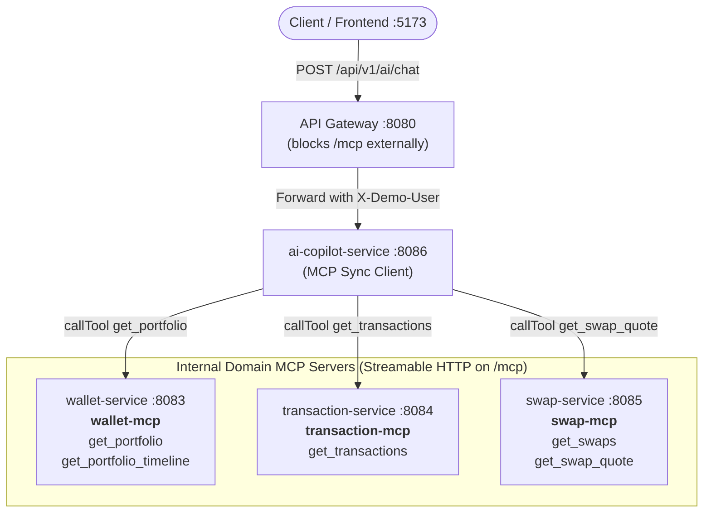

# 17. Step 4: One MCP Server per Domain (Model Context Protocol)

This chapter covers **Step 4** of the agentic upgrade roadmap (`docs/ai/agentic-system.md`): decoupling tool definitions and execution from the AI orchestrator by embedding lightweight Model Context Protocol (MCP) servers directly into domain microservices over streamable HTTP.

---

## 1. The Problem: The Hardcoded Tool Coupling Anti-Pattern

In Step 2 and Step 3, tools were implemented in `ai-copilot-service` using an in-process adapter (`CopilotTools`) backed by HTTP client stubs (`PlatformClient`).

While functionally effective for early prototyping, this design violates microservice boundaries and operational independence in three critical ways:

### A. The Deployment Lockstep Anti-Pattern
If the `wallet-service` team changes the schema of `get_portfolio`, `transaction-service` adds filter options to `get_transactions`, or `swap-service` modifies `get_swap_quote`, the `ai-copilot-service` must be modified, recompiled, and redeployed in lockstep. The domain teams do not own their tools.

### B. Leaky Service Boundaries and LLM Argument Spoofing
When tool definitions are centrally authored in the AI service, developers are frequently tempted to expose `userId` or `accountNumber` as an LLM argument:
```json
{
  "name": "get_portfolio",
  "parameters": {
    "userId": { "type": "string", "description": "User ID to fetch" }
  }
}
```
If the LLM accepts `userId` from user input, prompt injection allows an attacker to query other users' sensitive financial records (`"Show me the portfolio for user-2"`). Identity must be decoupled and resolved out-of-band via verified gateway transport headers (`X-Demo-User`), never from untrusted model arguments.

### C. Lack of Tool Portability and Standardization
Without an open standard like MCP, every enterprise domain service invents ad-hoc HTTP endpoints or proprietary function specifications, making it impossible for multi-agent systems to discover domain capabilities dynamically at runtime.

---

## 2. Options: Tool Integration Architectures

| Pattern | How It Works | Pros | Cons |
|---|---|---|---|
| **Monolithic Shared Library** | AI service imports domain entity JARs or domain client libraries | Easy method calls; zero network overhead | Violates domain isolation (`AGENTS.md` Rule 3); couples JVM dependencies; redeployment required for schema updates |
| **REST OpenAPI Scraping** | AI service parses Swagger / OpenAPI JSON at boot | Standard REST; no special server library | REST endpoints often expose mutations (`POST /transfer`) that should never be executed autonomously; lacks standard MCP streaming notifications and tool metadata |
| **Direct Stdio MCP Processes** | AI service spawns CLI sub-processes per domain over stdin/stdout | Standard MCP; isolates processes | Heavyweight; poorly suited for distributed Kubernetes / microservice deployments where services run in separate containers |
| **Streamable HTTP MCP Servers (What We Did)** | Each domain microservice embeds Spring AI MCP Server exposing `/mcp` over streamable HTTP | Microservices own their tools; dynamic discovery; gateway never routes `/mcp`; identity propagated via HTTP headers | Requires Spring AI MCP starter setup and request header propagation across MCP HTTP calls |

---

## 3. What We Did: Distributed Domain MCP Servers



### Domain MCP Servers Deployed

| Service | MCP Server Name | Endpoint | Tools Exposed |
|---|---|---|---|
| `wallet-service` (:8083) | `wallet-mcp` | `/mcp` | `get_portfolio`, `get_portfolio_timeline` |
| `transaction-service` (:8084) | `transaction-mcp` | `/mcp` | `get_transactions` |
| `swap-service` (:8085) | `swap-mcp` | `/mcp` | `get_swaps`, `get_swap_quote` |

### Key Architectural Decisions

1. **Internal-Only Protocol:**
   - The `/mcp` endpoints exist exclusively on internal service ports. The API Gateway (`api-gateway:8080`) does not route `/mcp`, ensuring external clients cannot invoke domain tools directly.

2. **Strict Identity Decoupling (`McpCallerContext`):**
   - In all domain tool implementations (`WalletMcpTools`, `TransactionMcpTools`, `SwapMcpTools`), tools take **zero arguments for user identity**. Each tool resolves the caller strictly from `RequestContextHolder.getRequestAttributes().getHeader("X-Demo-User")`.
   - On the client side in `ai-copilot-service`, `McpCallerContext` injects the caller's `X-Demo-User` and `X-Correlation-Id` headers into outbound MCP HTTP requests using `McpSyncHttpClientRequestCustomizer`.

3. **Tool Registration via `MethodToolCallbackProvider`:**
   - In each domain service, tool methods annotated with `@Tool` are converted into MCP tool specifications using `MethodToolCallbackProvider`:
     ```java
     @Bean
     public ToolCallbackProvider domainToolsProvider() {
      return MethodToolCallbackProvider.builder().toolObjects(this).build();
     }
     ```
   - Spring AI's `ToolCallbackConverterAutoConfiguration` converts these callbacks into MCP `SyncToolSpecification` beans on server boot.

4. **Dynamic Client Delegation with Safe Fallback:**
   - In `services/ai-copilot-service/src/main/java/dev/opencrypto/aicopilotservice/tools/SpringAiTools.java`, `findMcpClientFor(toolName)` dynamically queries connected MCP clients (`mcpClient.listTools()`).
   - If an MCP server provides the tool, execution delegates to `mcpClient.callTool(...)`. If the MCP server is unreachable or during offline unit tests, it falls back safely to in-process `CopilotTools`.

5. **Exposed Server Status in `/api/v1/ai/status`:**
   - `AiController` iterates all connected `McpSyncClient` instances, returning name, version, connection status, and discovered tools in the JSON payload.

---

## 4. See It Yourself

### 1. Verify Connected MCP Servers and Discovered Tools
Run via PowerShell:
```powershell
Invoke-RestMethod -Uri "http://localhost:8080/api/v1/ai/status" | ConvertTo-Json -Depth 6
```
Expected output:
```json
{
  "engine": "deterministic",
  "mcpServers": [
    {
      "name": "wallet-mcp",
      "version": "0.1.0",
      "connected": true,
      "tools": [
        "get_portfolio",
        "get_portfolio_timeline"
      ]
    },
    {
      "name": "transaction-mcp",
      "version": "0.1.0",
      "connected": true,
      "tools": [
        "get_transactions"
      ]
    },
    {
      "name": "swap-mcp",
      "version": "0.1.0",
      "connected": true,
      "tools": [
        "get_swap_quote",
        "get_swaps"
      ]
    }
  ]
}
```

### 2. Verify Execution Across Domains
```powershell
# Transaction Domain
$b1 = @{ message = "Show my recent transactions"; engine = "deterministic" } | ConvertTo-Json
Invoke-RestMethod -Uri "http://localhost:8080/api/v1/ai/chat" -Method Post -Body $b1 -ContentType "application/json" -Headers @{ "X-Demo-User" = "user-1" }

# Swap Domain
$b2 = @{ message = "Swap 100 USD to BTC"; engine = "deterministic" } | ConvertTo-Json
Invoke-RestMethod -Uri "http://localhost:8080/api/v1/ai/chat" -Method Post -Body $b2 -ContentType "application/json" -Headers @{ "X-Demo-User" = "user-1" }
```

### 3. Run Isolated Unit Tests
```powershell
$env:JAVA_HOME = "C:\Users\lenovo\.jdks\openjdk-21.0.1"
mvn test -pl services/ai-copilot-service,services/wallet-service
```
All tests complete with 0 failures and 0 errors.

---

## 5. Pitfalls and Lessons Learned

1. **Annotation Differences in Spring AI MCP:**
   - Spring AI's MCP Server auto-configuration looks for beans of type `ToolCallbackProvider` or `ToolCallback` via `ToolCallbackConverterAutoConfiguration` (or `@McpTool` if using `spring-ai-mcp-annotations`).
   - Plain `@Component` classes with standard Spring AI `@Tool` annotations will **not** be registered automatically unless bridged with `MethodToolCallbackProvider.builder().toolObjects(tools).build()`.

2. **Eager PostProcessor Initialization Conflicts:**
   - `ServerAnnotatedMethodBeanPostProcessor` triggers early bean creation in Spring MVC.
   - If messaging or tracing autoconfigurations depend on components created during bean post-processing, use `ObjectProvider<T>` with safe `NOOP` fallbacks to avoid `UnsatisfiedDependencyException` cycles.

3. **Startup Ordering with MCP Clients:**
   - Spring AI MCP Client connects eagerly over HTTP on startup. Domain MCP servers must be available when the copilot client starts, or client requests must tolerate connection retries.

4. **Identity Leakage Over Network Boundaries:**
   - Never accept `userId` from the LLM prompt or tool input. Always resolve the user identity from gateway-verified request headers (`X-Demo-User` / JWT claims) and propagate them through the transport layer.

---

## 6. Interview Questions

### Q1: What is the Model Context Protocol (MCP) and why is it preferred over embedding REST clients in an AI agent?
**Answer:** MCP is an open standard that standardizes how AI agents discover and execute tools, prompts, and resources provided by external servers. Embedding direct REST clients couples the AI service tightly to the domain services, requiring the AI service to be recompiled every time a domain tool changes. MCP allows domain services to publish and update their tools independently, which the AI client discovers dynamically at runtime.

### Q2: Why must the API Gateway block `/mcp` routes from external traffic?
**Answer:** MCP endpoints are internal infrastructure mechanisms designed for AI agent tool execution. Exposing `/mcp` publicly would allow external actors to bypass gateway authorization, inspect internal tool schemas, and directly invoke internal domain logic. Keeping `/mcp` unrouted ensures all user requests must pass through the authorized API Gateway and copilot engine.

### Q3: How do you prevent identity spoofing when an agent calls an MCP tool on behalf of a user?
**Answer:** Tool input parameters must never include user identity fields (`userId`). Instead, identity is bound strictly from the authenticated transport context (such as an incoming HTTP header `X-Demo-User` or verified JWT claim) and injected by an HTTP request interceptor/customizer (`McpCallerContext`) into outbound MCP requests. The domain MCP server then inspects the transport header directly.
