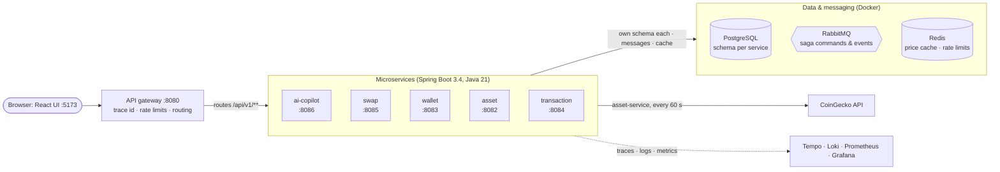

# Engineering notes: how OpenCrypto works and why

These notes explain the backend engineering in this project as **problems and their fixes**, so
you can learn the patterns, reproduce them, and talk about them in interviews. Every chapter has
the same shape:

1. **The problem**: what goes wrong without the technique.
2. **Options**: what you could do, and the trade-offs.
3. **What we did**: the decision, with links to the code.
4. **See it yourself**: commands to run against the local stack.
5. **Pitfalls**: mistakes that are easy to make.
6. **Interview questions**: what you should be able to answer afterwards.

## Reading order

| # | Chapter | You'll learn |
|---|---|---|
| 1 | [Architecture & data ownership](01-architecture.md) | Microservices boundaries, database-per-service, sync vs async calls, a shared platform library |
| 2 | [Market data integration](02-market-data.md) | Third-party API integration, adapters, Redis caching, scheduled jobs with ShedLock, stale data, pagination/sort/filter |
| 3 | [Double-entry ledger](03-ledger.md) | Financial invariants in the database, row locking, idempotency keys, holds, P/L, audit log, reconciliation |
| 4 | [Swap saga](04-swap-saga.md) | Distributed transactions without 2PC, state machines, transactional outbox, idempotent consumers, retries + DLQ, timeouts |
| 5 | [Rate limiting](05-rate-limiting.md) | Token bucket in Redis, client keys, cost-based policies, 429 + Retry-After |
| 6 | [Resilience](06-resilience.md) | Timeouts, retries with backoff, circuit breakers, graceful degradation, no network calls inside DB transactions |
| 7 | [Observability](07-observability.md) | Distributed tracing (W3C Trace Context, OpenTelemetry, Tempo), structured logs in Loki, RED + business metrics, exemplars, service map, alerts, dashboards as code |
| 8 | [Testing strategy](08-testing.md) | Unit vs integration tests, Testcontainers, WireMock, concurrency tests, deterministic tests, accessibility tests |
| 9 | [Frontend architecture](09-frontend.md) | Tailwind v4 + shadcn/ui + Lightweight Charts "pro exchange" UI, server state with React Query, error UX, code splitting, tested accessibility |
| 10 | [Real bugs we hit](10-bugs-and-lessons.md) | 24 real problems from building this project, with root cause and fix: your "hardest bug" interview stories |
| 11 | [Load testing](11-load-testing.md) | k6 open-model load tests, saturation and Little's law, diagnosing with traces, metastable failure, correctness under overload |
| 12 | [Publishing on GitHub with CI/CD](12-github-ci-cd.md) | GitHub Actions, reusable workflows, matrix builds, publishing images to GHCR, SemVer releases, branch rulesets, Dependabot, keeping secrets out of a public repo |
| — | [Resume bullets & interview stories](resume.md) | How to describe this project |

## The system in one picture

Diagrams in these notes are [Mermaid](https://mermaid.js.org/): GitHub renders them, and so does VS Code
with the *Markdown Preview Mermaid Support* extension. They're text, so they're reviewed and versioned
with the code. After editing one, `cd frontend && npm run docs:diagrams` renders all of them in a browser
and fails on a syntax error.



Who calls whom inside the box is in [chapter 1](01-architecture.md) (HTTP vs messages) and
[chapter 4](04-swap-saga.md) (the saga).

## Run it

```bash
scripts/run-local.sh                    # infra in Docker, services on your machine (or .\scripts\run-local.ps1)
cd frontend && npm install && npm run dev   # http://localhost:5173
mvn verify                              # 49 unit + Testcontainers integration tests (needs Docker)
```

Useful URLs: Grafana http://localhost:3000 (dashboards "OpenCrypto overview" with the service map, "OpenCrypto logs" and "Request trace"), Prometheus alerts
http://localhost:9090/alerts, RabbitMQ http://localhost:15673 (opencrypto / localdev_only_change_me).
